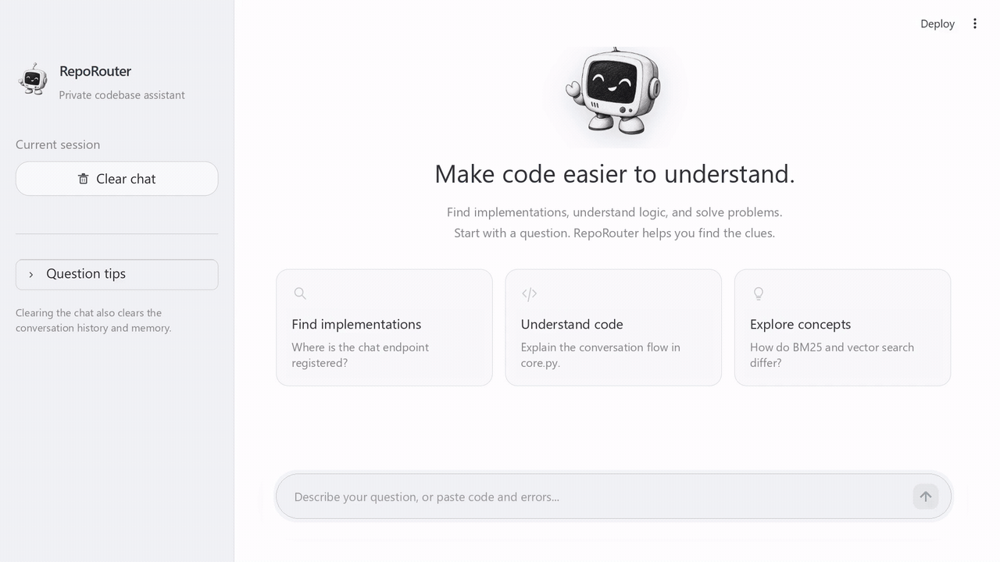

# RepoRouter - An AI Development Assistant for Code Repositories

**Decide whether to look through the code → Retrieve → Answer → Evaluate**

[Quick start](#quick-start) · [Code entry points](#code-entry-points) · [Experiment reports and raw data](#where-the-data-is)

[Early demo: asking it to explain how the project's BM25 retrieval is implemented](#my-early-work-hand-writing-the-agent-loop-and-rag) · [Fine-tuning process](#how-the-small-router-model-was-trained) · [Course knowledge map](#what-i-learned-for-this-project)

[](https://github.com/Mrch1io/RepoRouter/actions/workflows/ast_ci.yml)
[](requirements.txt)
[](src/api/routes.py)
[](web_ui.py)
[](src/rag/vectorstore.py)

[](src/agent/llm.py)
[](lora/autodl/train_qwen35_4b.yaml)
[](src/agent/router.py)

**Language / 语言**: English | [简体中文](README_CN.md)

## At a Glance

**Goal**: have a coding assistant first decide whether a question requires looking through the code, and only then retrieve and answer. The decision is made by a small 4B model I fine-tuned with LoRA; that's what the "Router" in the project name refers to.

**The most solid result**: on nanochat, a new repo never used before (60 questions), the router model got 41 / 45 / 41 right across three training runs before questions were added, and 52 / 55 / 55 after adding 140 boundary questions. Neither group saw a repo summary in training or at inference, so the only difference is the added questions; the deployed v2, trained with the summary and given it at inference, got 55 / 56 / 50. The one run that only added training steps, without adding questions, still got 41.

**I did three things**:

1. **Fine-tuned a 4B router model**: built the training data myself (497 → 637 examples), trained with LoRA, then quantized it to GGUF for deployment (Q4 for short). The percentages here are the share of "whether to search the code" decisions (search / don't search / ask a follow-up first) that were right: v1 scored 98% on 50 in-distribution questions (from the same generator as the training questions), but only 81.6% on 87 human-written questions about this repo, about the same as the original model without fine-tuning (80.5%), which shows it had learned the question style rather than the judgment itself; v2, with 140 boundary questions added, reached 95.0% (mean of 3 seeds), on par with the original 9B model and DeepSeek Flash. Once plugged into the system, compared with the native pipeline where DeepSeek decides on its own whether to search, both sides had 81 of the 90 end-to-end answers marked correct by the LLM judge, while Q4 was about 1.5 s faster per question and cost about 39% less on the answering side. ([Training process](#how-the-small-router-model-was-trained) · [Study 2](#2-can-a-small-4b-model-learn-when-to-search-the-code) · [Study 4](#4-is-plugging-the-4b-router-into-the-system-worth-it))
2. **Built RAG and evaluated it piece by piece**: chunking, embeddings, vector retrieval, BM25 hybrid retrieval, reranking, soft fuse. While double-checking the evaluation results, I found two problems that distorted them: first, BM25's tokenization rule only recognized English letters and digits, so a Chinese question had not a single token left after tokenization and retrieved nothing at all; second, the file holding the test questions had been indexed into the retrieval store, so a search could hit the question itself, turning it into an "open-book exam". After fixing both, I re-ran the evaluations, and everything below uses the corrected results. ([Study 3](#3-is-hybrid-retrieval-really-better-than-pure-vector-retrieval) · [Problem 7](#7-test-questions-leaked-into-the-indexed-codebase))
3. **Built an evaluation I can trust**: routing, retrieval and answers are tested separately as three layers; cheap baselines such as keyword rules and similar-question lookup are run first, and the new repo's questions were frozen and evaluated only once; comparisons are paired question by question and come with confidence intervals, and a human blind review spot-checks the automatic judge. ([Study 2](#2-can-a-small-4b-model-learn-when-to-search-the-code) · [Study 5](#5-can-my-evaluation-itself-be-trusted))

**Conclusions for the five questions**:

| Question                                     | Conclusion                                      | Decision              |
| -------------------------------------------- | ----------------------------------------------- | --------------------- |
| [Can retrieval distance alone decide whether to search the code?](#1-can-retrieval-distance-alone-decide-whether-to-search-the-code) | No: it blocks clearly unrelated questions, but not ones that sound like they're about this repo | Soft fuse off by default; the router decides |
| [Can a small 4B model learn when to search the code?](#2-can-a-small-4b-model-learn-when-to-search-the-code) | Yes, and simple rules and similar-question lookup can't match it; but trained only on generator-written questions, it doesn't learn | Use v2, with the repo summary at inference |
| [Is hybrid retrieval really better than pure vector retrieval?](#3-is-hybrid-retrieval-really-better-than-pure-vector-retrieval) | Not better: worse at first, and only drew even after the tokenization fix; what helps is reranking | Pure vector only online; reranking moved to [next steps](#future-improvements) |
| [Is plugging the 4B router into the system worth it?](#4-is-plugging-the-4b-router-into-the-system-worth-it) | Consistently faster, with lower API costs; no measurable difference in quality | Native pipeline by default; Q4 optional if you have a GPU |
| [Can my evaluation results be trusted?](#5-can-my-evaluation-itself-be-trusted) | Useful as a reference, but I think the judge is lenient and the automatic scores may be optimistic; the data and question-set problems found so far have all been fixed. | Scores are still listed, but written as "81 marked correct by the LLM judge", never "90% accuracy" |

## Why I Built This

The two most annoying things about writing code: writing documentation yourself, and taking over someone else's undocumented code. Worse, the code changes every day while the docs are hard to keep in sync, so either the docs go stale or developers have to keep patching them. My reason for starting this project was honestly quite simple and blunt: I wanted a large language model to take over this most tedious grunt work, to try generating documentation automatically from the code, and to keep the ongoing maintenance cost as low as possible. The ideal: when the code moves, the docs follow automatically.

Only after building the first version did I discover that it would look through the codebase even for a question like "How do I read a txt file in Python?": of 50 questions unrelated to the code, 32 triggered a search ([log](data/e2e_eval_log.jsonl)). For a model to write docs from the code, it first has to know which questions require looking through the code and which can be answered from general knowledge, and that step alone is a real head-scratcher. So I shifted my focus to a more specific question: **when should the assistant read the code, and which tool should it use**, and fine-tuned a small 4B model with LoRA to make that call. It scored 98% on test questions from the same source as the training questions, but only 81.6% once I switched to 87 human-written questions about this repo. Ever since, this project has been answering one question: can this score actually be trusted? "When the code moves, the docs follow automatically" hasn't been achieved yet; I've left it in [Future Improvements](#future-improvements).

## Showcase

### One complete Q&A



### How the small model decides whether to search: 5 real questions

Here is how the small model decides whether to search the code on 5 real questions: the first two both mention FastAPI, but one needs a search and the other doesn't; the last one is a question it got wrong.

<sub>The questions come from the second round of the 90-question end-to-end evaluation, with the test-question files already excluded from the index; Q4 decides whether to search, and DeepSeek Flash writes the answer. Time covers the whole question, from asking to answer; cost counts only the DeepSeek calls on the answering side.</sub>

| Question                               | Small model's decision                                             | What happened                                                                             | Time / cost       |
| -------------------------------------- | ------------------------------------------------------------------ | ----------------------------------------------------------------------------------------- | ----------------- |
| Which router is the FastAPI chat endpoint mounted under? | `tool_call`: `search_codebase("chat_endpoint FastAPI router path")` | The top 3 retrieved chunks come from `api/routes.py` and `main.py`; judged correct        | 2.17 s / $0.00090 |
| How do you usually register a new route in FastAPI? | `no_tool`                                                          | Also mentions FastAPI, but asks about the general way to write it, so it answers directly; judged correct | 2.77 s / $0.00053 |
| Which messages does the multi-turn memory pruning in `_prune_memory` drop? | `tool_call`: `search_codebase("_prune_memory 记忆裁剪 保留哪些消息")` | The top 4 retrieved chunks all come from `agent/core.py`; judged correct                  | 3.56 s / $0.00061 |
| What is BM25?                          | `no_tool`                                                          | A general concept, answered directly; judged correct                                      | 4.02 s / $0.00070 |
| What is the JSON structure that the `search_codebase` tool returns to the model? | `no_tool` (wrong)                                                  | The answering model said it needed to search first, wrote "(calling tool: search_codebase …)" in its reply, then admitted it "can't actually execute tool calls right now" and asked the user for permission to search; the question went unanswered, and the judge gave it 2 points | 2.45 s / $0.00030 |

<sub>[Answers](data/v2/clean90/e2e_q4.jsonl) · [Scores](data/v2/clean90/judge_q4.jsonl). The first two rows share the keyword FastAPI, yet one needs a search and the other doesn't; that is exactly the boundary the router model has to learn. The last row is an unsolved problem: the small model judged a question about the tool itself as needing no search; meanwhile the answering model's system prompt required that "if a search is needed, you must call the tool", but this pipeline gave it no tools at all, so it ended up writing "calling the tool" out as text. Across 5 runs of the 90 questions, this question was missed every time. The fix has two parts: on the answering side, a separate system prompt has already been swapped in, requiring it to say so honestly when there are no retrieval results and not to pretend to call tools; on the router side, the next step is to add a batch of training questions about the assistant's own tools and the routing format.</sub>

## 📖 Features

Main capabilities:

- **Routing decision (core)** - First decide whether a question needs a look through the code and which tool to use: DeepSeek can decide on its own, or the decision can go to the small Qwen3.5-4B model I fine-tuned with LoRA and quantized to GGUF (Q4)
- **Retrieval-augmented generation (RAG)** - Split the code into chunks, turn them into vectors stored in Chroma, and at question time retrieve the most relevant chunks for the model to answer from; any local repo can be indexed, and Python files can be chunked by syntax tree
- **6 callable tools** - code search, static analysis, code completion, log analysis, Dockerfile generation, unit test generation
- **Evaluation framework** - routing, retrieval and answers are tested separately as three layers; each question records time and cost, and small-sample conclusions come with confidence intervals
- **Engineering** - FastAPI endpoints + Streamlit web UI + GitHub Actions

**Use cases**: understanding an unfamiliar codebase, Q&A about implementation details in a repo, code quality checks, debugging from logs, generating Dockerfiles and unit tests

<details>
<summary>Expand for all features: deciding, retrieval, tools</summary>

### Deciding: whether to look through the code

- 🧭 **Two switchable routing pipelines**: the native pipeline (native) lets DeepSeek decide on its own whether to call tools; small-model routing (`phase2a`) has the Qwen3.5-4B I fine-tuned with LoRA first output a one-line routing JSON (`tool_call` / `no_tool` / `clarify_needed`, plus the tool name and arguments), and the large model only writes the answer; the fine-tuned model is quantized to GGUF Q4_K_M and deployed locally with llama.cpp (training data, the two rounds of fine-tuning and the evaluation are in [Study 2](#2-can-a-small-4b-model-learn-when-to-search-the-code))
- 🔁 **No spinning in place**: the model sometimes calls the same tool with the same arguments over and over, getting the same result and just wasting time and money. Now a given tool with the same arguments runs only once; on a repeat call it is reminded "already searched: answer if you have enough information, otherwise try different keywords"; a question gets at most 5 rounds, after which it stops
- 🛡️ **Validation before execution**: if the tool name isn't in the tool table, or an argument is missing, has the wrong type or is out of range, the call isn't executed and the reason is handed back to the model
- 🧠 **Multi-turn memory**: a sliding window keeps only the questions and final answers; intermediate tool results are removed from memory once they've been used

### Retrieval augmentation (RAG): find the relevant code first, then answer

- 🔍 **Vector retrieval**: each code chunk is turned into a string of numbers and stored in Chroma (qwen3.7 embeddings, 1024 dimensions); at question time it finds the chunks closest in meaning. I also implemented "keyword search (BM25) + merging the two result lists (RRF)" and "a second pass with a reranking model", which can be switched on for comparison during evaluation
- ✂️ **Two chunking modes**: by default, split by character count, which is simple but may cut a function in half; or split along Python's syntax structure (AST), keeping whole functions and classes where possible; oversized functions are split further, with the enclosing class and function added as context, and line numbers still map to the original code
- 🛑 **Soft fuse and query rewriting** (optional, off by default): if the nearest code chunk is farther away than a threshold, the retrieval results aren't passed to the model
- 📦 **Any local repo can be indexed**: run `build_knowledge_base.py --repo-path <repo path>` to index any local repository

### Tools

- 🔬 **analyse_code**: AST static analysis (mutable default arguments, bare except, overly long functions, cyclomatic complexity, unused imports); GitHub Actions also uses it to scan this repo on pushes and PRs to main
- 🧪 **generate_tests**: generates pytest tests and actually runs them; if they fail or coverage is below 80%, it rewrites them with the error output
- 🪵 **analyse_log**, 🐳 **generate_dockerfile**, ⌨️ **complete_code**

</details>

### Interfaces

<details>
<summary>Expand for the web UI and API</summary>

- **Web UI** ([web entry point](web_ui.py), Streamlit): below the chat window is an expandable status panel that lists, step by step, what happened for that question: the small model's dispatch decision (when using small-model routing), which tool was called, which files were hit (with line numbers for the AST index), whether the soft fuse fired, and finally the time taken and estimated cost.
- **API** ([API entry point](src/main.py), FastAPI): `POST /api/v1/chat` separates sessions by `session_id`; `/api/v1/analyse-code`, `/api/v1/generate-dockerfile` and `/api/v1/log-analyse` call a single tool directly; `/docs` is the auto-generated API documentation.

</details>

### Architecture


## How the Small Router Model Was Trained


How each step was done, and which course knowledge it drew on:

| Step     | What I did                                                                                          | Related CS336 course knowledge                                                                |
| -------- | --------------------------------------------------------------------------------------------------- | --------------------------------------------------------------------------------------------- |
| Building data | Gemini wrote questions about a fictional internal project, ModelHub-Serve, so the model couldn't have seen it beforehand; rule-based cleaning + manual review fixed 9 labels and removed 3 duplicates, giving v1's 497 examples | Filter low-quality text with rules, and find duplicate content with hashing. The scale here is much smaller: the cleaner checks fields, labels and arguments against rules, flags uncertain cases for me to look at, and deletes duplicate questions outright |
| Adding data | v1 scored only 81.6% on this repo, so based on its mistakes I added 100 "implicit search" questions, which ask about the project's own classes and functions without ever saying "check the code", and 40 "general questions with project terms", for 637 examples in v2 | Adding data based on the mistakes was something I worked out in this project                  |
| Chat template | `qwen3_5_nothink`: "thinking" is turned off for both training and inference, and the model outputs a one-line routing JSON directly | In both SFT and evaluation, questions are wrapped in the same prompt template before going to the model; once the training and inference formats differ, the model is seeing a different kind of input |
| Loss on the response only | The v2 example in the log has 1135 tokens, and only the last 56 (the routing JSON + the end token) count toward the loss; the whole prompt is masked out | Tokenize the prompt and response together, then use a response mask to compute cross-entropy only on the response tokens, so the prompt doesn't take part in training; LLaMA-Factory does the same by default |
| Parameter-efficient fine-tuning | LoRA: r=16, α=32, dropout 0.05, on all linear layers; vision encoder frozen; trainable parameters are only 0.71% | Extended self-study: LoRA freezes the original model and only adds two low-rank matrices beside each linear layer to learn the change in the weights; with fewer parameters to train, the memory taken by optimizer state shrinks too |
| Optimizer and learning rate | AdamW, learning rate 1e-4, warmup over the first 10% of steps, then cosine decay, 3 epochs          | Implementing AdamW from scratch (first- and second-moment estimates, plus decoupled weight decay), and a learning-rate schedule that "warms up linearly, then comes down along a cosine curve" |
| GPU memory | batch 2 × gradient accumulation 4 (effective batch 8); at batch 4 a single copy of the logits is about 8.1 GB, which runs out of memory ([Problem 5](#5-a-4b-model-on-a-32gb-gpu-yet-batch-4-runs-out-of-memory)) | Estimating how much memory the parameters, activations, gradients and optimizer state each take; splitting a batch into several micro-batches and accumulating gradients before a single update, which is equivalent to a large batch |
| Precision | bf16 training                                                                                       | Mixed-precision training runs matrix multiplications in bf16 to save memory and gain speed, while numerically sensitive parts stay in fp32; the logits are cast back to fp32 for the cross-entropy, which is also why the logits take up so much memory in Problem 5 |
| Quantization and deployment | Merge LoRA back into the base model, convert to GGUF Q4_K_M (2.52 GiB), and serve it with llama.cpp as an OpenAI-compatible service; on the 87 this-repo questions, bf16 and Q4 both got 82 right | Extended self-study: compressing weights from 16 bits to about 4 makes the model smaller and means less data to read at inference time; Q4_K_M is a mixed quantization that keeps some of the more sensitive weights at 6 bits |
| Evaluation | 50 in-distribution, 87 this-repo and 60 new-repo (nanochat) questions; each condition trained 3 times | UW Machine Learning: use the test set only once, at the very end, so the 60 new-repo questions were frozen and evaluated only once; each condition was trained 3 times to see the variation caused by the seed |

<sub>[Training config](lora/autodl/train_qwen35_4b.yaml) · token counts in the [v2 training log](data/v2/logs/v2/train_4b_v2.log) · scores before and after quantization in the [bf16 log](data/v2/logs/v2/lora4b_v2_ood_eval.log) and the [Q4 log](data/v2/logs/v2/route_ood_gguf_Q4_K_M.log) · the full record of the data construction is in the [data construction report](评估/第二版/02-数据构建.md).</sub>


<sub>Training loss from one run each with seeds 43 and 44, counting only the routing JSON tokens. The two versions' curves nearly overlap, yet they generalize very differently: training loss can't tell you whether a model generalizes; you have to test it on a fresh batch of unseen questions, see [Study 2](#2-can-a-small-4b-model-learn-when-to-search-the-code).</sub>

## Evaluation Design: Each Question Set Answers One Question

| Question set  |     Count | What it answers           | File                                                                        |
| ------------- | --------: | ------------------------- | --------------------------------------------------------------------------- |
| Routing training set v1 / v2 | 497 / 637 | (for training)            | [v1](lora/routing_train_v1_no_summary.json) · [v2](lora/routing_train.json) |
| In-distribution routing test |        50 | Did the model learn this batch of data? | [In-distribution test set](lora/eval_in_domain.json)                        |
| This-repo dev/validation set |        87 | Can it still decide in a real repo? Used during iteration to find problems and decide which questions to add; these are the 90 end-to-end questions below minus the 3 where either decision counts as correct | [This-repo validation set](lora/eval_cross_repo.json)                       |
| nanochat frozen test |        60 | Can it still decide in a real repo it has never seen? | [nanochat frozen questions](data/v2/newrepo_nanochat60/questions_frozen.jsonl) |
| Retrieval questions |        18 | What rank does the expected source file get? | [Retrieval question set](src/evaluation/rag_dataset.py)                     |
| Distance questions |        90 | Can retrieval distance separate the questions that should be searched from the ones that shouldn't? | [Distance question set](src/evaluation/soft_fuse_dataset.py)                |
| End-to-end questions | Same set as the distance questions | Is the full answer right, how fast, how expensive? | [Reference answers](src/evaluation/e2e_manifest.py)                         |

- **Three layers tested separately**: routing decisions, retrieval evidence and final answers each have their own questions and metrics, and aren't merged into a single "accuracy".
- **Failures count in the denominator**: model output that fails to parse counts as wrong and isn't removed from the denominator. The old evaluation code returned early on parse failures and once turned 27/31 into 27/30; after the fix I added a regression test ([parse failures still count in the denominator](tests/test_routing_metrics.py)).
- **Offline reproduction**: the routing training and test sets can be rebuilt and compared item by item without a network connection.
- **Per-question accounting**: time, tokens, DeepSeek cache hits and estimated cost are all recorded per question.
- **Intervals even for small samples**: Wilson intervals, bootstrap intervals, McNemar exact test ([statistical methods](src/evaluation/stats.py)).
- **Question writer, answerer and grader kept separate**: Gemini generates the training questions, DeepSeek answers, Qwen acts as the judge; finally, a human blind review follows a sampling rule fixed in advance.

## What I Researched: Go/No-Go Decisions Based on Evidence

For an overview of the five questions' conclusions, see [At a Glance](#at-a-glance). Full result tables and raw records are collected in the [second-version evaluation directory](评估/第二版/README.md).

### 1. Can retrieval distance alone decide whether to search the code?

- **Setup**: 90 questions (40 need a search of this repo, 50 don't), each forced to retrieve once, looking at how far the nearest code chunk is from the question; if it's too far, the question is blocked from searching. I first set a rule that at most 3 of the 40 should-search questions may be wrongly blocked, then found the threshold that blocks the most within that limit; character / AST chunking and standard / Flash embeddings were each tested.
- **Conclusion: distance alone isn't enough. It blocks clearly unrelated questions, but not ones that "sound like they're about this repo".**
  - Clearly unrelated general questions, such as "How do I read a txt file in Python?", are almost all blocked: 25–28 out of 28.
  - General questions with project terms are only half blocked (5–6 of 12), and deliberately misleading boundary questions only 2–4 (of 10). The repo happens to contain `bm25.py`, so "What is BM25?" is closer to the code than most this-repo questions.
  - Overall, the default character chunking + standard embedding blocks 33/50, and the best, AST + standard embedding, blocks 36/50.
- **Decision**: the soft fuse is only an optional fallback, off by default; whether to search the code is left to the router model ([Study 2](#2-can-a-small-4b-model-learn-when-to-search-the-code)).


<sub>Clean index with character chunking + standard embedding; everything to the right of the vertical line is blocked, with 3/40 false blocks and 33/50 blocked. The full setup, the eight baselines and the record of failed reproductions are in the [retrieval and soft fuse report](评估/第二版/04-检索与软熔断.md).</sub>

> [!TIP]
> **What I learned**:
> - AUC measures overall ability across all thresholds; in deployment you can only pick one threshold, and what you actually get is the block rate at that point.
> - Decide the false blocks you can accept first, then choose the threshold. If you look at the results first and then pick a threshold, you can always find a nice-looking number.
> - The threshold was chosen on the same 90 questions it was then measured on, so the result is optimistic and still needs validation on an independent question set.
>
> **Applied knowledge**:
> - Imperial's Mathematics for Machine Learning covered how inner products, distances and angles relate: the squared distance between unit vectors equals 2 − 2cosθ, so a threshold of 0.905 simply means "block if the nearest code chunk's cosine similarity is below about 0.55". (Math is awesome!)
> - UW Machine Learning's classification course covered how precision and recall trade off against each other, and that when false positives are costly, precision comes first, so here I capped false blocks first. It's the same idea as "when in doubt, don't merge" in my manga translation project: a wrong merge mashes two people's lines into one sentence, while a missed merge at worst makes the translation a bit stiff.

<details>
<summary>Expand for the derivation: how distance converts to cosine, and why false blocks are capped first</summary>

- ‖a − b‖² = ‖a‖² + ‖b‖² − 2⟨a, b⟩. The vectors in the store are all 1024-dimensional unit vectors, ‖a‖ = ‖b‖ = 1, so the squared distance = 2 − 2cosθ. Chroma uses squared L2 distance by default, and a threshold of 0.905 corresponds to cosθ = 1 − 0.905 / 2 ≈ 0.55. Distance and cosine are just two ways of writing the same quantity.
- Here "blocking" is the positive call: block a question that should be searched (a false block), and the answer has no grounding in the code at all; let an unrelated question through, and the cost is just the model reading a few irrelevant chunks, which is relatively small. So cap false blocks first, then push the block rate as high as possible within that cap.

</details>

### 2. Can a small 4B model learn "when to search the code"?

- **Setup**: the task is the same as in March: given a question, the model outputs only a one-line routing JSON saying whether to search the code, which tool to use and with what arguments. v1 was trained on 497 regenerated and reviewed examples; v2 added 140 boundary questions and put a repo summary in front of every example. I first tested on 50 in-distribution questions and 87 this-repo questions, then ran ablations and a steps-only control with three seeds, and finally validated on nanochat's 60 frozen questions. Training details are in [How the Small Router Model Was Trained](#how-the-small-router-model-was-trained) above.
- **Conclusion: it can learn, but not from generator-written questions alone.**
  - **Cheap methods can't replace it**: first, the approaches that don't train a model. Keyword rules get 70.1% on the 87 this-repo questions and 71.7% on nanochat; having the 5 most similar training questions vote gets 82% on in-distribution questions but only 44.8% on this-repo questions, lower than answering "don't search" for everything (59.8%) (it often misjudges questions as "needs a follow-up question"; even counting only search vs. no search, it's just 69.0%). For comparison, the original 4B model without fine-tuning gets 80.5% / 65.0% on this-repo questions / nanochat, and v2 without the summary (mean of three seeds) gets 92.0% / 83.9%. ([Cheap baseline results](data/v2/cheap_baselines/run.json))
  - v1 got 49 of 50 in-distribution questions right, but only 81.6% on the 87 this-repo questions, about the same as the original 4B model without fine-tuning (80.5%); of the 35 questions that should have been searched, it searched only 19, even fewer than the original's 26. What it learned was the generator's question style, not the judgment itself.
  - v2, with 140 boundary questions added, averages 95.0% over three seeds, on par with the original 9B model and DeepSeek Flash (the same score doesn't mean the same ability).
  - On nanochat, never used before, the effect of adding questions still holds. With no repo summary at inference for either: v1's three seeds get 41 / 45 / 41, and the version with only the added questions, also trained without the summary, gets 52 / 55 / 55; the two groups don't overlap. The run that only added training steps still got 41.
  - On nanochat with the summary at inference: v2 gets 55 / 56 / 50, the original 4B gets 48, and DeepSeek Flash and V4 Pro both get 55. It transfers to a new repo, but seeds differ by up to 6 questions, so there is still variation.
- **Decision**: use v2, with the repo summary provided at inference.


<sub>First-round v1/v2: 50 in-distribution questions and 87 this-repo questions; the horizontal lines are Wilson 95% intervals.</sub>


The full data pipeline is in [Data construction](评估/第二版/02-数据构建.md); every condition, the three seeds, and the steps and nanochat comparisons are in the [router fine-tuning report](评估/第二版/03-路由微调.md).

> [!TIP]
> **What I learned**:
> - A high in-distribution score only shows that the model learned this batch of data. When training and test questions come from the same generator, scores are systematically inflated.
> - Run the cheapest baselines first; only then do you know whether a complex approach is worth it. Similar-question lookup is very accurate on in-distribution questions, but on a different repo it does worse than "never search", which shows it just memorized what the training questions look like, the same mistake v1 made.
> - Change one condition at a time, or you can't say what deserves the credit. v2 changed both the data and the summary, and it took the ablation to separate the two; adding data also changed the number of training steps along the way, so a steps-only control was needed too.
> - A single training run's score can't be taken as a conclusion: v1 lands anywhere from 69 to 73 just by changing the seed, and v2 gets 50–56 on the new repo. When conditions differ by a question or two, compare that with the variation between seeds first.
> - Every training example carried the same summary, so I assumed the model would learn to ignore it. The opposite was true: on the 87 this-repo questions, removing the summary at inference cost all three seeds 1–4 questions, showing that it does use the summary. With no summary at inference for either, including the summary in training made little difference on those 87 questions (92.0% vs 92.7%); on nanochat, the v2 trained with the summary got 11 fewer right (151 vs 162 across three seeds). If the summary is in training, it's best given at inference too.
>
> **Applied knowledge**:
> - When UW Machine Learning's regression course covered model selection, it stressed that the test set can only be used once, at the very end. Between v1 and v2 I used these 87 questions to find problems and decide which questions to add, so strictly speaking they had become a validation set. That's why I hand-wrote another 60 questions for a repo I'd never used, froze them, and evaluated only once.
> - When I hand-wrote SFT in CS336 Assignment 5, a response mask was used to compute the loss on the response only. The same applies here: of a v2 example's 1135 tokens, only 56 take part in training, so the model only practices "which routing JSON to output", and the prompt itself doesn't enter the loss.

### 3. Is hybrid retrieval really better than pure vector retrieval?

- **Setup**: the retrieval store is this project's own `src/` directory, under 90 chunks after character chunking (87 in the old index; the clean index for ②③ has 75, rebuilt after the code had changed). 18 retrieval questions in four types: exact keyword, Chinese semantic, English semantic, and mixed Chinese-English. I look at where the expected source file ranks in the top 8 results and score it with MRR: rank 1 scores 1, rank 2 scores 0.5, rank 3 scores 1/3, and so on, averaged at the end; the closer to 1, the better. Three kinds of retrieval are compared: pure vector (Dense), keyword (BM25), and hybrid retrieval (Hybrid), which merges the two rankings by rank position.
- **Conclusion: not better. I expected fusion to be stronger, but it was clearly worse at first, and after the fix it only drew even; what actually raised the score was reranking.**

| MRR | Dense | Hybrid |
|---|---:|---:|
| ① At first (old index) | 0.903 | 0.565 |
| ② Before the Chinese tokenization fix (clean index) | 0.944 | 0.838 |
| ③ After splitting Chinese into single characters (same clean index) | 0.944 | 0.935 |
| ④ Retrieve 24 candidates, then let a reranking model pick the top 8 (old index) | 1.000 | 1.000 |

<sub>Compare only within each row. ①④ and ②③ don't use the same index, so you can't subtract across rows.</sub>

- **Why it was worse at first**: it only showed up when broken down by question type (see the chart below). BM25's tokenizer regex only recognized English letters and digits, so the 5 Chinese questions had not a single token left after tokenization; every code chunk scored 0, and BM25 could only return the first few chunks of the index as-is; when the rankings were merged, these unrelated chunks got mixed into the results. On those 5 Chinese questions alone, Hybrid scores 0.402 and Dense 0.850.
- **After the fix**: with Chinese split into single characters, Hybrid rose from 0.838 to 0.935, about the same as Dense's 0.944. With only 18 questions, a gap this small can't be told apart, so all I can say is that it drew even.
- **Decision**: online retrieval stays pure vector, and hybrid retrieval doesn't go live; reranking works best, but it has only been validated offline on the 18 questions with the old index, so plugging it into online retrieval is in [Future Improvements](#future-improvements).


<sub>MRR by question type (old index, character chunking + standard embedding): BM25 scores 0 on every Chinese question, dragging Hybrid below Dense. The full comparison is in the [retrieval report](评估/第二版/04-检索与软熔断.md).</sub>

> [!TIP]
> **What I learned**:
> - Fusion doesn't automatically make things better. RRF merges two rankings by rank position, assuming both are worth something; if one of them is in random order, merging dilutes the good results instead.
> - An average can hide "one category is entirely wrong": 0.565 doesn't reveal the problem, but breaking it down by question type makes it obvious.
> - If every question retrieves the same chunks, the scores are all identical: the `sorted` in the old code is a stable sort, which keeps the original order on ties, so it was always the first few chunks of the index.
> - The store holds only 75–87 chunks, there are only 18 questions, and only file hits are checked, so the conclusions apply very narrowly; a larger repo would need to be tested again.
>
> **Applied knowledge**:
> - When writing the BPE tokenizer in CS336, the first step is regex pre-tokenization, and the GPT-2 pattern uses `\p{L}` to match letters in any language. My original BM25 regex only recognized ASCII, so Chinese was thrown away entirely at this step.
> - UW Machine Learning's retrieval course covered TF-IDF: words that appear often in this document but rarely in others matter more. BM25 is an improved version of it, but only once the words have been split out.

### 4. Is plugging the 4B router into the system worth it?

- **Setup**: v2 is quantized to Q4_K_M and served with llama.cpp as the routing service, and DeepSeek Flash only writes the answers; the control group lets Flash decide on its own whether to call tools (the native pipeline). The same 90 questions are answered once by each pipeline and compared question by question, with an automatic judge deciding right or wrong. There were two rounds in total: one on the original index, and another on the clean index with the test-question files excluded (see [Problem 7](#7-test-questions-leaked-into-the-indexed-codebase)).
- **Conclusion: faster and cheaper on API costs, for sure; no measurable difference in quality, but 90 questions can't prove the two are equally good either.**

| Clean-index round, per-question average | Native pipeline | Q4 routing |
|---|---:|---:|
| Judged correct | 81/90 | 81/90 |
| Time | 5.43 s | 3.97 s |
| Answer-side DeepSeek cost | $0.00121 | $0.00075 |
| Answer length | 1606 characters | 1037 characters |

- **Faster and cheaper**: Q4 is about 1.5 s faster per question (95% CI 1.2–1.7 s) and about 39% cheaper on the answering side, in the same direction in both rounds. Not all of the savings are the router's doing: the Q4 pipeline calls DeepSeek only 0.98 times on average (1.36 for native), and its answers are a third shorter.
- **No measurable difference in quality**: in the clean-index round both sides got 81 right, with 8 questions each where one was right and the other wrong, an exact tie; the first round was 83 to 79, also not a significant difference (McNemar p = 0.34).
- **The accounting isn't complete**: the cost comparison covers only the answer-side DeepSeek calls. The Q4 pipeline also needs a GPU to run the router model, which the native pipeline doesn't, and that part isn't counted; if you had to run a GPU just for it, the API savings might not cover it.
- **Neither side was seeing these questions for the first time**: drop the 3 questions where either decision counts as correct, and these 90 are exactly the 87 this-repo questions from Study 2; the 140 questions added for v2 were chosen from v1's mistakes on those 87. The native pipeline's system prompt was also tuned on these 90 questions back in March (wrong searches fell from 33 to 2, see the [prompt retest record](archive/early-experiments/评估/09-提示词优化复测.md)), and the examples it gives, "what is quicksort", "how do you register a FastAPI route" and "what is BM25", are 3 of them. So this is a comparison on a development set; full answers from both pipelines on a new repo haven't been tested yet (see [Future Improvements](#future-improvements)).
- **Decision**: the native pipeline stays the default, and Q4 routing is an optional mode (`routing_backend=phase2a`).


Results for each round, deployment overhead and paired intervals are in the [quantization and system integration report](评估/第二版/05-量化与系统接入.md).

> [!TIP]
> **What I learned**:
> - System-level comparisons should be paired: having both pipelines answer the same question once each is far more reliable than two averages that each tell their own story.
> - Running the same setup twice, the native pipeline's number of searches already differed by 2 questions. When you see a gap of two or three questions in a single run, compare it with the variation across repeated runs first.
> - The missed question (last row of the [Showcase](#showcase)) exposed a conflict of responsibilities: the shared system prompt at the time required "if a search is needed, you must call the tool", yet the small-model routing pipeline gave the answering model no tool list. What a model can do has to be written into both the prompt and the interface.
> - The two pipelines ran in a fixed order, and caching, API load and time of day could all affect timing; these confounders weren't eliminated.
>
> **Applied knowledge**: combinatorics and probability from Discrete Mathematics: the McNemar exact test only looks at the questions where the two pipelines reached different verdicts. If the two are actually equally good, which one is right on each of these questions is like a coin flip, and the p-value is the probability in both tails of the binomial distribution.

<details>
<summary>Expand to see how p = 0.34 is computed</summary>

In the first round, the verdicts differed on 10 questions, split 3 : 7. The probability of a 3 : 7 split or something more lopsided is 2 × (C(10,0) + C(10,1) + C(10,2) + C(10,3)) / 2¹⁰ = 2 × 176 / 1024 ≈ 0.34. The clean-index round was 8 : 8, an exact half-and-half split; the same formula gives a value above 1, which is capped at 1. That is exactly how the [McNemar test](src/evaluation/stats.py) computes it.

</details>

### 5. Can my evaluation itself be trusted?

- **Setup**: a human blind review of the first round's 90 questions. First, 10 questions were drawn at random by a rule fixed in advance, plus the 11 questions where the automatic judge scored the two pipelines differently, for 21 questions and 42 answers in total; with the pipeline behind each answer hidden, I graded them one by one. I also checked the sources that retrieval returned, and whether the training and test questions overlapped.
- **Conclusion: useful as a reference, but the judge is lenient and the automatic scores may be optimistic; the data and question-set problems found so far have been fixed.**
  - **The judge is lenient**: of the 10 random questions, the judge marked both pipelines all correct, while by my reading each had 1 (p38) that was only partially correct. Of the 11 questions where the judge's scores disagreed, I graded 9 answers from each pipeline as not fully correct, and the judge had marked 5 of the native pipeline's and 2 of Q4's as correct. The sample is too small to say whether it favors one side, but the automatic scores can't be taken directly as accuracy.
  - **The data had holes**: test-question files had leaked into the retrieval store; after excluding them I re-ran a round (see [Problem 7](#7-test-questions-leaked-into-the-indexed-codebase)).
  - **A question set got "dirty"**: the 87 this-repo questions had already been used during iteration, so final validation switched to the 60 frozen nanochat questions (see [Study 2](#2-can-a-small-4b-model-learn-when-to-search-the-code)); and among the 50 in-distribution questions, 1 is word-for-word identical to a training question.
- **Decision**: the automatic scores for both rounds are still listed, but written as "81 marked correct by the LLM judge", never as "90% accuracy", because the judge is lenient; the human spot check only covered 21 questions, so the ratios it found aren't extrapolated to all 90 questions either.

The blind review, the two-judge comparison and the p04/p24/m04 error cases are in the [answer quality report](评估/第二版/06-回答质量与复盘.md); the 1 question among the 50 that overlaps the training set is in [Data construction](评估/第二版/02-数据构建.md).

> [!TIP]
> **What I learned**:
> - Evaluation is code too, and it has bugs too; and when it goes wrong, every conclusion goes wrong with it.
> - Fix the sampling rule first and look at the results afterwards; that's the only way to keep yourself from picking samples that favor your conclusion. Randomly drawn questions and deliberately chosen disagreement questions should be counted separately.
> - Once you've made a decision with a test set, it's no longer a test set.
>
> **Applied knowledge**: when CS224N covered machine translation evaluation, it pointed out that automatic metrics like BLEU don't always agree with human judgment, so human evaluation is needed as a backstop. The same goes for using an LLM as a judge.

## What I Learned for This Project

<details>
<summary>Expand to see where each course was used (click a link to jump to that section)</summary>

| Self-taught course | What I learned → where it's used |
| --- | --- |
| CS50x | Hash table keys must be normalized first (Speller's case-insensitive lookup) → [sorting the arguments before checking call fingerprints for duplicates](#1-the-agent-spinning-in-place-the-same-tool-called-over-and-over); Flask sessions → [isolating conversation memory per session](#2-several-people-chatting-at-once-memory-leaking-into-other-peoples-conversations); check50's automatic tests → [generated tests have to actually be run](#3-generated-unit-tests-have-to-actually-be-run) |
| Python for Everybody | Regular expressions and JSON parsing → [finding a valid routing JSON in the model's output](#6-how-to-reliably-catch-the-small-models-json-output); and it was a single line of regex that made [BM25 drop Chinese](#3-is-hybrid-retrieval-really-better-than-pure-vector-retrieval) |
| CS336 | Resource accounting → [why batch 4 runs out of memory](#5-a-4b-model-on-a-32gb-gpu-yet-batch-4-runs-out-of-memory); regex pre-tokenization before BPE → [BM25 tokenization dropping Chinese](#3-is-hybrid-retrieval-really-better-than-pure-vector-retrieval); SFT chat templates → [turning off "thinking" for both training and inference](#6-how-to-reliably-catch-the-small-models-json-output); hand-written AdamW and cosine schedule, mixed precision, gradient accumulation, loss on the response only → [How the Small Router Model Was Trained](#how-the-small-router-model-was-trained); data deduplication and test-set decontamination → [test questions leaking into the retrieval store](#7-test-questions-leaked-into-the-indexed-codebase) |
| CS224N | The "retriever + reader" of open-domain QA → [RAG: retrieve first, then answer](#3-is-hybrid-retrieval-really-better-than-pure-vector-retrieval); word vectors and similarity → [vector retrieval and the distance threshold](#1-can-retrieval-distance-alone-decide-whether-to-search-the-code); the gap between automatic metrics and human evaluation → [an LLM judge needs human spot checks](#5-can-my-evaluation-itself-be-trusted) |
| Mathematics for Machine Learning | Inner products and angles → [squared distance = 2 − 2cosθ, so a threshold of 0.905 is roughly cosine 0.55](#1-can-retrieval-distance-alone-decide-whether-to-search-the-code) |
| UW Machine Learning | The precision-recall trade-off → [set a cap on false blocks first, then choose the threshold](#1-can-retrieval-distance-alone-decide-whether-to-search-the-code); use the test set only once, at the end → [I had already made the 87 questions "dirty"](#2-can-a-small-4b-model-learn-when-to-search-the-code); TF-IDF retrieval → [BM25](#3-is-hybrid-retrieval-really-better-than-pure-vector-retrieval) |
| Extended self-study | LoRA → [training only 0.71% of the parameters](#how-the-small-router-model-was-trained); model quantization → [the 87-question score unchanged after Q4 quantization](#how-the-small-router-model-was-trained) |
| Discrete Mathematics | Combinatorial counting and the binomial distribution → [McNemar exact test: p = 352 / 1024](#4-is-plugging-the-4b-router-into-the-system-worth-it) |

</details>

## Problems I Ran Into

### 1. The agent spinning in place: the same tool called over and over

- **Problem**: the agent would sometimes call the same tool with exactly the same arguments over and over until it hit the iteration limit; you can see "Duplicate call detected: search_codebase" in the March demo recording. The first interception only looked at the tool name, which caused the opposite problem: when the model changed keywords to search again, that was blocked as a duplicate too.
- **Approach**:
  - Call fingerprint = tool name + `json.dumps(args, sort_keys=True)`, stored in a set; a call is blocked only when both the tool and the arguments are the same ([conversation loop](src/agent/core.py)).
  - A blocked call isn't executed, but it still gets a `tool` message back, reminding the model: if it has enough information, answer directly; if not, search again with different keywords.
  - At most 5 iterations per turn. At the limit it stops, and still prunes memory, so unpaired tool messages aren't carried into the next turn.

<details>
<summary>Verification</summary>

- [Duplicate-call and round-limit tests](tests/test_agent_loop.py): repeated calls with the same arguments are blocked, while calls with changed arguments run as usual; it stops after reaching 5 rounds.

</details>

> [!TIP]
> **What I learned**:
> - "Same" has to be defined first: the same arguments with the keys in a different order turn into a different string, so sort first, then compare.
> - Blocking doesn't mean not replying: an OpenAI-format API requires every tool_call the assistant sends to have a tool reply with the matching id. The interception message is itself feedback to the model, telling it what to do next.
>
> **Applied knowledge**: CS50x's Speller assignment has you write your own hash table, and lookups are case-insensitive: Foo and foo have to be lowercased before hashing so they land in the same place. Call fingerprints work the same way: when the same arguments differ only in key order, `sort_keys` first turns them into the same string, so the call can be recognized as the same one.

### 2. Several people chatting at once: memory leaking into other people's conversations

- **Problem**: the earliest FastAPI endpoints had just one global RepoRouter instance, so all users shared a single conversation memory: a question A had just asked would show up in B's context.
- **Approach**: create one Agent per `session_id` in the request, only when it's first needed; keep at most 100 sessions and delete the oldest beyond that ([session management](src/api/routes.py)). The endpoint functions use plain `def`, so FastAPI runs them in a thread pool and synchronous LLM calls don't block other requests.
- **Constraint**: two simultaneous requests in the same session will still modify the same memory at the same time; the cost counter `USAGE` is a process-wide global variable, so concurrent requests reset each other's counts. That's fine for a single-user demo, but before a multi-user deployment it still needs locks, or per-request accounting.

<details>
<summary>Verification</summary>

- [Session isolation test](tests/test_api.py): ask one question in each of two `session_id`s; the second session still counts its own turns from 1 (the test model answers "第1问：b"), so the first session's question never entered its memory.

</details>

> [!TIP]
> **What I learned**: where state lives determines the level of isolation: a module-level variable is shared by the whole process, a dict keyed by `session_id` gives one copy per session, and getting one copy per request means splitting things up further.
>
> **Applied knowledge**: CS50x's Flask assignment Finance uses sessions to remember who each user is; the same principle applies here, except that what needs remembering changes from "the logged-in user" to "the conversation memory".

### 3. Generated unit tests have to actually be run

- **Problem**: `generate_tests` originally just returned the tests the model wrote, as-is, without ever running them. Only when I later inspected the tool did I discover that the prompt had been written as `f"\ncode\n"`, so the code under test was never passed to the model at all: it had been writing tests for code it couldn't see, and the tests even looked quite convincing.
- **Approach** ([test generation implementation](src/agent/tools/test_generation.py)):
  - The code under test and the tests are written to a temporary directory and pytest is run in a subprocess, with a 30-second timeout (generated code may contain infinite loops).
  - Borrowing from qodo-cover: if pytest-cov is installed, coverage is checked too. If the tests fail, or coverage is below 80%, pytest's output (including the uncovered line numbers) goes back to the model for a rewrite, with at most 3 generations.
  - If pytest-cov is installed but no coverage is reported for `target.py` (for example, the generated tests never imported the code under test), that also counts as a failure and is rewritten with a hint. Previously, this case was treated as "pytest-cov not installed" and let through.
  - If all 3 attempts fail, it honestly returns the last error instead of pretending to succeed.
- **Constraint**: a temporary directory plus a timeout is not a sandbox. The generated code runs on the local Python, inherits the current environment variables, and has no file or network isolation.

<details>
<summary>Verification</summary>

- [Test generation regression tests](tests/test_generate_tests.py): both passes and failures are recognized; infinite loops are killed after the timeout; after a failure it rewrites with the error until the tests pass; when coverage is too low it asks for more tests; when no coverage is reported it asks for a rewrite, and failing to get coverage 3 times counts as a failure; without pytest-cov it still checks only pass or fail.

</details>

> [!TIP]
> **What I learned**:
> - Until it's run, model-generated code only "looks right". This bug shows exactly that from the output alone, it's hard to notice that the input was wrong.
> - "Passes" and "actually tests something" are two different things. Coverage gives the second one a checkable standard, but high coverage doesn't mean the assertions are right.
>
> **Applied knowledge**: every CS50x assignment has to pass check50's automatic tests first. Here I hold the model to the same requirement, so it gets to take the class too (heh).

### 4. An empty `__init__.py` turned 1024-dimensional vectors into 2560-dimensional ones

- **Problem**: after switching to syntax-tree (AST) chunking, the vector dimensions didn't match when building the index: the store had 1024 dimensions, but a new batch came back with 2560. It turned out that an empty `__init__.py` produced empty chunks, and when a batch contains an empty string, the qwen3.7 embedding API returns the whole batch at 2560 dimensions.
- **Approach**: explicitly pass `dimensions=1024` when embedding ([vector retrieval](src/rag/vectorstore.py)); AST chunking skips whitespace-only chunks ([syntax-tree chunking](src/rag/splitter.py)) and also records each chunk's start and end line numbers, so retrieval results can point straight to "which lines".

<details>
<summary>Verification</summary>

- All 110 chunks in the AST index are 1024-dimensional; [chunking regression tests](tests/test_splitter.py) check that short functions stay whole, that large functions keep their enclosing context when split, and that line numbers map back to the original.

</details>

> [!TIP]
> **What I learned**: an API's default behavior can change with its input. Pin down key parameters (dimensions) explicitly, and filter abnormal input (empty chunks) at the source; you need both safeguards.

### 5. A 4B model on a 32GB GPU, yet batch 4 runs out of memory

- **Problem**: I was training Qwen3.5-4B with LoRA on a rented RTX 5090 (32GB). Going by the 4B parameter count, there should have been memory to spare, but with batch size set to 4, it ran out of memory while computing the loss (there's a comment about it in the [training config](lora/autodl/train_qwen35_4b.yaml)).
- **Approach**:
  - batch 2 × gradient accumulation 4, so the effective batch is still 8.
  - Train only LoRA (r=16, α=32, covering all linear layers) and freeze the model's built-in vision encoder: 32,464,896 trainable parameters, 0.71% of all 4,571,730,432 parameters.
  - For the remaining training settings, see [How the Small Router Model Was Trained](#how-the-small-router-model-was-trained).

<details>
<summary>Verification</summary>

- Training logs: v2 trained for 240 steps on 637 examples, taking 47 min 35 s; v1 used 497 examples and took 36 min 21 s. The trainable parameter count and vocabulary size both come from the same log.

</details>

> [!TIP]
> **What I learned**:
> - Do the math first: logits size = batch × sequence length × vocabulary size. Qwen3.5's vocabulary has 248,320 tokens; at a cutoff length of 2048 in fp32, one copy of the logits at batch 4 takes 4 × 2048 × 248,320 × 4 bytes ≈ 8.1 GB, and computing the cross-entropy also stores intermediate results and gradients of the same size. By comparison, the 4B model's bf16 weights are about 9.1 GB (4.57 billion × 2 bytes). This is an upper bound based on the longest sequences; in practice each batch is only padded to its longest example.
> - In a large-vocabulary model, the output-layer term grows linearly with batch size and sequence length, and can easily exceed the weights themselves. Gradient accumulation trades time for memory while keeping the effective batch the same.
>
> **Applied knowledge**: CS336's first assignment has you work out by hand a Transformer's parameter count and how much memory the activations and optimizer state each take. Here the same calculation is applied to the output layer.

### 6. How to reliably catch the small model's JSON output

- **Problem**: the router model is supposed to output only a one-line JSON, such as `{"decision_type":"tool_call","tool_name":"search_codebase","arguments":{"query":"..."}}`. But the actual output may include explanatory text or code fences, or give a decision type outside the agreed set; once parsing fails, the whole turn of the conversation can't continue. Even when parsing succeeds, the tool name and arguments may be invalid: an output like `{"decision_type":"tool_call","tool_name":[]}` used to error out only at execution time, at the tool-table lookup step.
- **Approach**:
  - [Routing JSON parsing](src/agent/router.py) tries `json.JSONDecoder.raw_decode` starting from every `{`, and only accepts objects whose `decision_type` is a string and one of the three types.
  - If all attempts fail, it falls back to `no_tool`, marks `parse_failed` in the trace, and hands the question to the large model to answer directly, so the error isn't silently swallowed.
  - Before execution, the [tool execution entry point](src/agent/core.py) first confirms that the tool name is in the tool table, then uses [tool argument validation](src/agent/tools/schemas.py), written with BFCL as a reference, to check the arguments against the tool definition: required arguments can't be missing or empty strings, types must be right, there can be no arguments outside the tool definition, and `top_k` must be between 1 and 50. If anything is invalid, the call isn't executed; the reason is handed back to the model as the tool result, and the error is recorded in the trace. The native and the small-model routing pipelines share this step.
  - At inference, pass `enable_thinking: False` to match the `qwen3_5_nothink` template used in training, so the model doesn't "think" at length before producing its output.

<details>
<summary>Verification</summary>

- [Routing parsing and tool validation tests](tests/test_agent_loop.py): check routing JSON parsing and argument validation; invalid tool names or arguments aren't executed and the error is recorded; a valid call runs exactly once.
- On the 87 this-repo questions, the quantized Q4 model's output was parseable for 87/87 ([log](data/v2/logs/v2/route_ood_gguf_Q4_K_M.log)).
- Both rounds of the 90-question end-to-end evaluation ran before this step was added; none of the 360 answers had a tool call error, so it hasn't yet blocked an invalid call in a real run.

</details>

> [!TIP]
> **What I learned**:
> - Parsing and validation are two separate steps.
> - A fallback should leave a trace; otherwise everything looks fine while things are actually quietly degrading.
> - The chat template must be the same in training and inference: change the template, and the model sees a different input format.
>
> **Applied knowledge**: when Python for Everybody parsed responses from web APIs, it wrapped `json.loads` in try/except and skipped the item if parsing failed; here I go one step further and record the failure in the trace. When CS336 covered SFT, training and inference also used the same prompt template.

### 7. Test questions leaked into the indexed codebase

- **Problem**: while checking the retrieval records of the end-to-end evaluation, I noticed that many questions were retrieving code chunks from `soft_fuse_dataset.py`. Looking into it, I found that the original text of the 90 evaluation questions was written right in this file, and it had been indexed along with the rest of the code, so a search could directly hit the test question itself. How big was the impact? On the original index, for 33 of the 90 questions, the nearest code chunk came from a test-question file; in the first round of the end-to-end evaluation, 27 of the native pipeline's 34 searches retrieved test-question files, as did 21 of Q4's 33, and across both sides, 11 searches hit the exact text of the question being asked.
- **Approach**:
  - The easiest fix would have been to exclude all of `src/evaluation/`, but I didn't. The evaluation scripts are also ordinary code in the repo, and some questions should retrieve them: for a question like "how does the retrieval evaluation compute MRR", the correct evidence is `eval_retrieval.py`.
  - In the end I excluded only the 4 files that actually hold test questions and reference answers (15 chunks in total under character chunking), listed in the [question-set exclusion list](src/rag/loader.py); the directories holding experiment results and training data are kept out of the index too.
  - The clean index was built into a new directory and the original index left untouched, so the first round's results can still be reproduced; the index-building script errors out on an existing directory instead of overwriting it.
  - The affected evaluations were redone on the clean index: the soft fuse threshold was recalibrated, and the 90-question end-to-end evaluation was re-run for another round.

<details>
<summary>Verification</summary>

- Nearest code chunk from a test-question file: 33/90 → 0/90 ([original index](data/v2/soft_fuse_rebaseline/baseline_src.json) · [clean index](data/v2/soft_fuse_rebaseline/baseline_src_frozen90_clean.json)).
- End-to-end searches retrieving test-question files: native 27/34, Q4 21/33 → 0/32 for both; the evaluation scripts are still retrieved normally, 17 and 14 times respectively ([retrieval audit](data/v2/clean90/retrieval_audit.json)).
- Soft fuse: AUC 0.80 → 0.85; at the same 7.5% false-block rate, blocked unrelated questions rose from 28/50 to 33/50.

</details>

> [!TIP]
> **What I learned**:
> - With test questions mixed into the searched store, even something as seemingly objective as "distance" gets distorted. Make sure the data is clean before talking about thresholds.
> - The exclusion has to be just the right size: remove too much, and you also remove correct evidence that should have been retrieved.
>
> **Applied knowledge**: when CS336 covered data, it stressed checking whether the test set had leaked into the training corpus (decontamination). This is the same problem, except that what got contaminated isn't the training data but the retrieval store.

## Code Entry Points

- **Two routing pipelines** [conversation loop](src/agent/core.py) · [small-model routing](src/agent/router.py): the native pipeline (`native`) and small-model routing (`phase2a`) share the same tool execution entry point (which validates tool names and arguments before execution) and trace; each question records time, tokens, cache hits and estimated cost ([model calls](src/agent/llm.py)).
- **Routing data pipeline** [data processing scripts](experiments/routing_data/): generation, rule-based cleaning, manual revision, merging, export to ShareGPT; the 497 / 637-example training sets can be reproduced item by item without a network connection ([data reproduction script](experiments/routing_data/reproduce_data.py)).
- **Training and deployment** [training and deployment configs](lora/autodl/): LLaMA-Factory configs for LoRA training, merge-and-export and GGUF quantization; the routing service runs on a rented RTX 5090, connected through an SSH tunnel.
- **Retrieval evaluation** [retrieval quality](src/evaluation/eval_retrieval.py) · [soft fuse evaluation](scripts/eval_soft_fuse.py): 4 indexes (character / AST chunking × two embeddings), reranking, soft fuse threshold calibration.
- **End-to-end evaluation** [answer evaluation](scripts/eval_agent.py) · [automatic grading](src/evaluation/llm_judge_e2e.py) · [statistical methods](src/evaluation/stats.py): full answers, an automatic judge, per-question paired statistics.
- **Tools** [tool implementations](src/agent/tools/): 6 tools, of which `generate_tests` actually runs pytest.

## Quick Start

Requires Python 3.12 and API keys for DeepSeek and Alibaba Cloud Model Studio (Bailian, for Qwen embeddings).

```powershell
python -m venv .venv
.\.venv\Scripts\Activate.ps1
pip install -r requirements.txt
copy .env.example .env    # fill in deepseek_api_key and qwen_api_key

# Index src/. The target must be a new directory: if it already exists, the script refuses to overwrite it and errors out
python scripts/build_knowledge_base.py --repo-path src --persist-dir data/indices/demo
# Then in .env, set Chroma_persist_dir to ./data/indices/demo and bm25_persist_dir to ./data/indices/demo/bm25_index.pkl

streamlit run web_ui.py              # web UI
uvicorn src.main:app --port 8000     # API, docs at http://127.0.0.1:8000/docs

python -m pytest                     
```

To use your own small router model: first serve the GGUF as an OpenAI-compatible service with llama.cpp, then set `routing_backend=phase2a` and `router_base_url=http://127.0.0.1:8080/v1` in `.env`. The v1 and v2 LoRA adapters are on Hugging Face: [v1](https://huggingface.co/Mrch1io/RepoAgent-Qwen3.5-4B-LoRA-v1) and [v2](https://huggingface.co/Mrch1io/RepoAgent-Qwen3.5-4B-LoRA-v2); the GGUF file is large and isn't uploaded, but it can be exported from the adapter by following the [training and deployment guide](lora/autodl/README.md).

## Limitations

- Routing has only been tested on two repos: the 87 this-repo questions were used repeatedly during iteration, the 90 end-to-end questions are the same set, and the native pipeline's prompt was tuned on them too; the 60 nanochat questions were evaluated only once, but the questions, reference answers and review all came from me alone.
- Each training condition was trained only 3 times, and the steps-only control only once; sample sizes of 50, 60, 87 and 90 questions are only enough to detect fairly large differences.

## Future Improvements

1. **Fix the small model's missed searches, then repeat the evaluation**: add a batch of training questions about the assistant's own tools and the routing format, retrain, and focus on rechecking p04, p18 and p29, which are missed every time; re-test the separate system prompt now used in the answering stage as well. This time, run the 90 questions several times and widen the human spot checks, then validate full answers on nanochat, to tell whether differences come from the approach or from sampling noise.
2. **Plug reranking into online retrieval**: first re-test reranking on the clean index, then wire it into `search_codebase` and use the 90-question end-to-end evaluation to look at the number judged correct, time and cost (reranking adds one API call per search). In the clean-index round, the questions that searched the code but were judged only partially correct numbered 6 for the native pipeline and 4 for Q4; questions like these might benefit.
3. **Handle concurrency and execution isolation**: queue requests within the same session and account costs per request; provide a truly isolated environment for generated test code.
4. **Return to generating docs from code**: update the index incrementally by file hash, then turn "write module docs from the code" into a tool, so the docs update along with the code.

## My Early Work: Hand-Writing the Agent Loop and RAG

<details>
<summary>Expand to see the first version from March: a demo screenshot and the hand-written BM25 tokenizer function</summary>

In March, I wrote the first version of this project from scratch: the agent loop, vector + BM25 retrieval, a few tools, a Streamlit web UI and FastAPI endpoints; back then it still relied on DeepSeek to decide on its own whether to call tools. Below is a demo from that time: asked how the project's BM25 retrieval is implemented, it first searches the source code, then writes a structured explanation. This is exactly the "write docs from the code" I originally wanted, except that one answer took 35 seconds.


The Chinese comments in the code are notes I wrote while learning, and I've kept them all. Below is the BM25 tokenizer function I wrote in March ([BM25 tokenizer implementation](src/rag/bm25.py)):

```python
#1.暴力分词器：利用正则表达式去掉非字母数字下划线
#私有内部辅助函数，私有变量：标注_
def _tokenize(text : str)->List[str]:
    tokens = re.split(r"[^A-Za-z0-9_]+",text) #r:表示原生字符串，不需要转义；+表示一个或多个字符；^表示取反，把非那些的切掉

    #返回切好的字符串列表(去空)，工整
    return [t for t in tokens if t]
```

The comment says "把非那些的切掉" ("cut away whatever isn't one of those"). Only later did I realize that Chinese characters aren't "one of those" either, so a Chinese question gets cut away entirely; see [Study 3](#3-is-hybrid-retrieval-really-better-than-pure-vector-retrieval). This line has since been changed to keep identifiers and split Chinese into single characters.

When I picked the project up again, I was surprised to find that DeepSeek had retired the `deepseek-chat` I'd been using all along, and the whole project wouldn't run; that became the starting point of this overhaul: switching to `deepseek-flash`, regenerating the training data, retraining the router model on Qwen3.5, and redoing all the evaluations.

</details>

## Where the Data Is

The [second-version evaluation directory](评估/第二版/README.md) lists the reports, data, logs and implementation entry points in one place:

| What you're looking for | Report |
|---|---|
| Metrics, question-set purposes and experiment batches | [01 Problem and baselines](评估/第二版/01-问题与基线.md) |
| The 497 / 637 training examples and their review | [02 Data construction](评估/第二版/02-数据构建.md) |
| Routing comparisons, three seeds and nanochat | [03 Router fine-tuning](评估/第二版/03-路由微调.md) |
| Retrieval, Chinese tokenization and distance thresholds | [04 Retrieval and soft fuse](评估/第二版/04-检索与软熔断.md) |
| Q4 deployment, the two 90-question rounds and overhead | [05 Quantization and system integration](评估/第二版/05-量化与系统接入.md) |
| Automatic judge, human blind review and error cases | [06 Answer quality and retrospective](评估/第二版/06-回答质量与复盘.md) |

The March models, data and indexes all differ from the second version's, so the historical material is kept separately in the [early experiments archive](archive/early-experiments/README.md) and isn't put side by side with the second version's results to claim improvements.

This project was previously called RepoAgent and is now RepoRouter; the `RepoAgent` that appears in logs, server paths and evaluation questions is the old name for the same project.

## Acknowledgments

- Open-source projects used: LLaMA-Factory, llama.cpp, Chroma, LangChain, rank-bm25, astchunk.
- Model services used: DeepSeek (answering), Qwen (Tongyi Qianwen; embeddings, reranking, judging, and the base of the router model), Gemini (generating training questions).
- Ideas borrowed: BFCL (counting "should call" and "shouldn't call" separately, argument validity checks), qodo-cover (coverage targets), the cAST paper (chunking by syntax tree).
