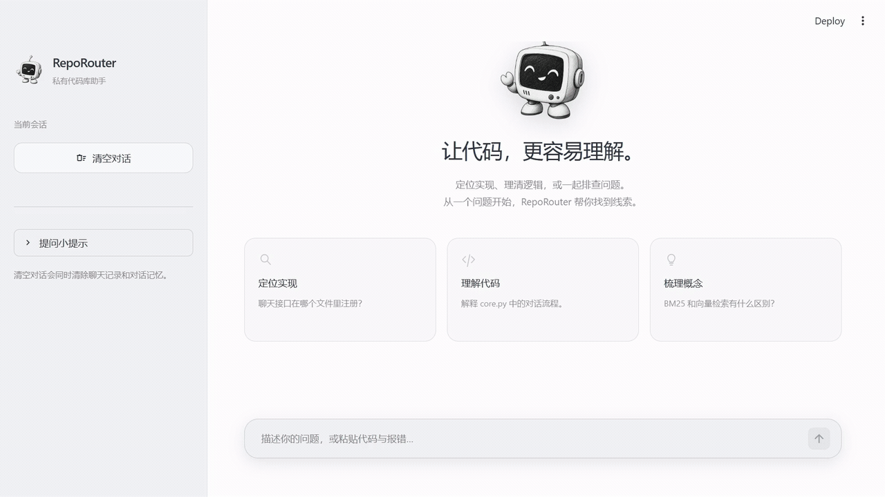
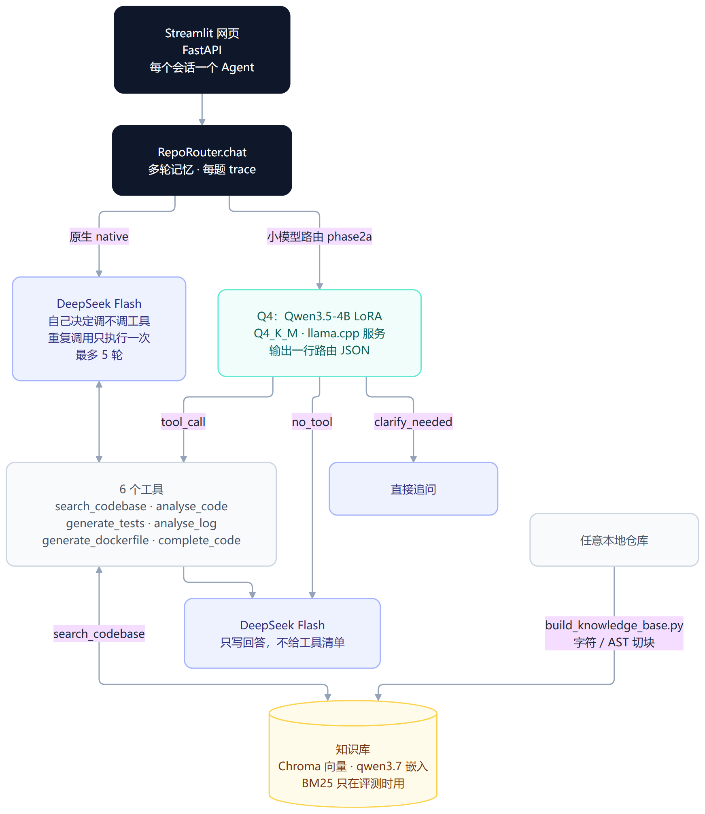
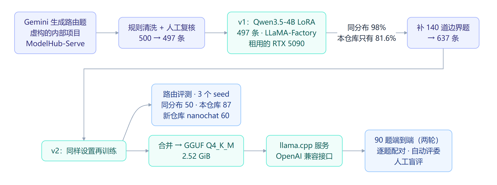
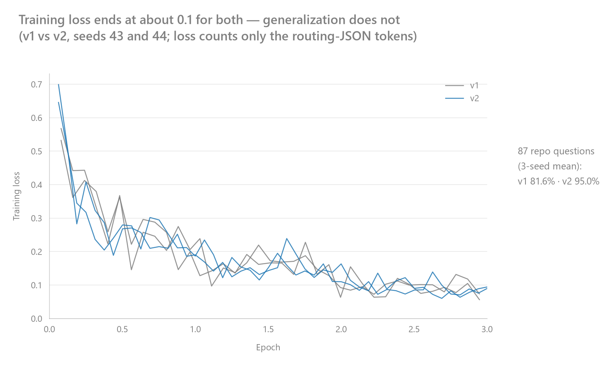
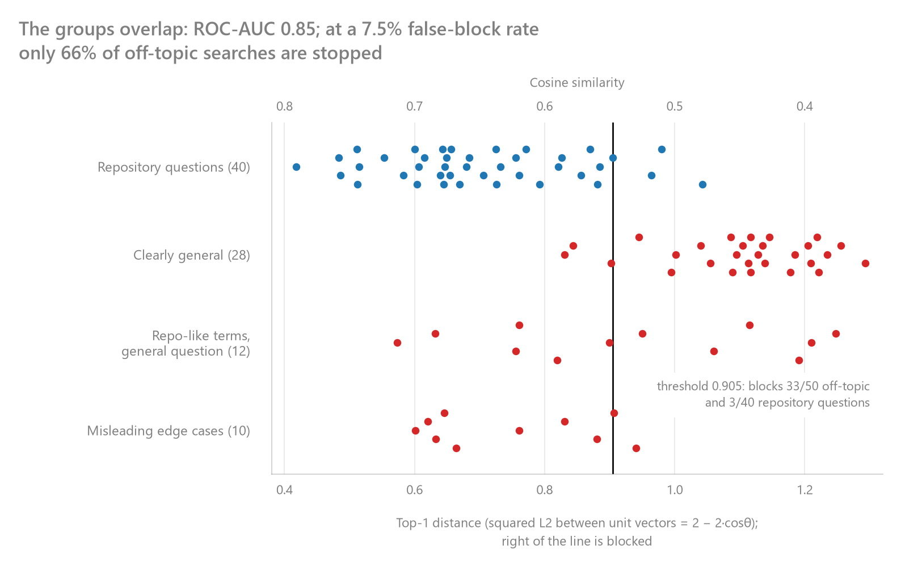
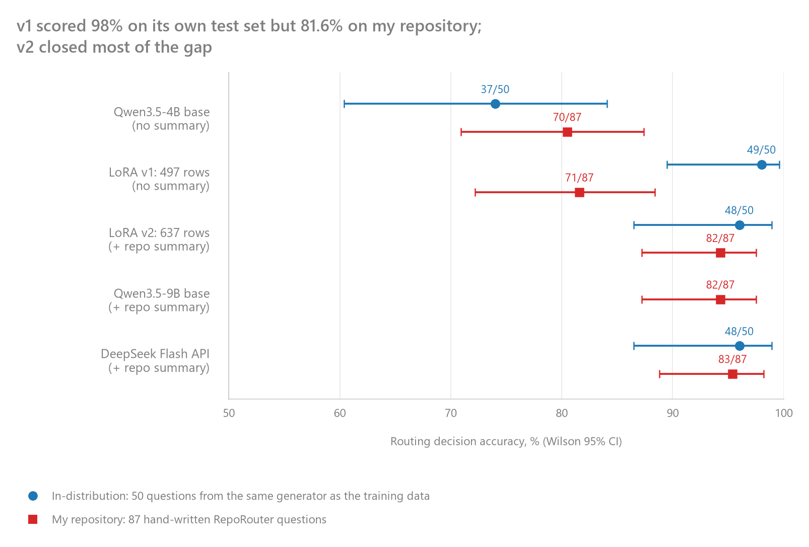
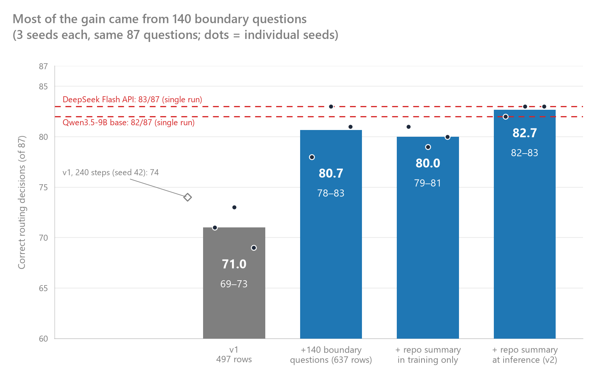
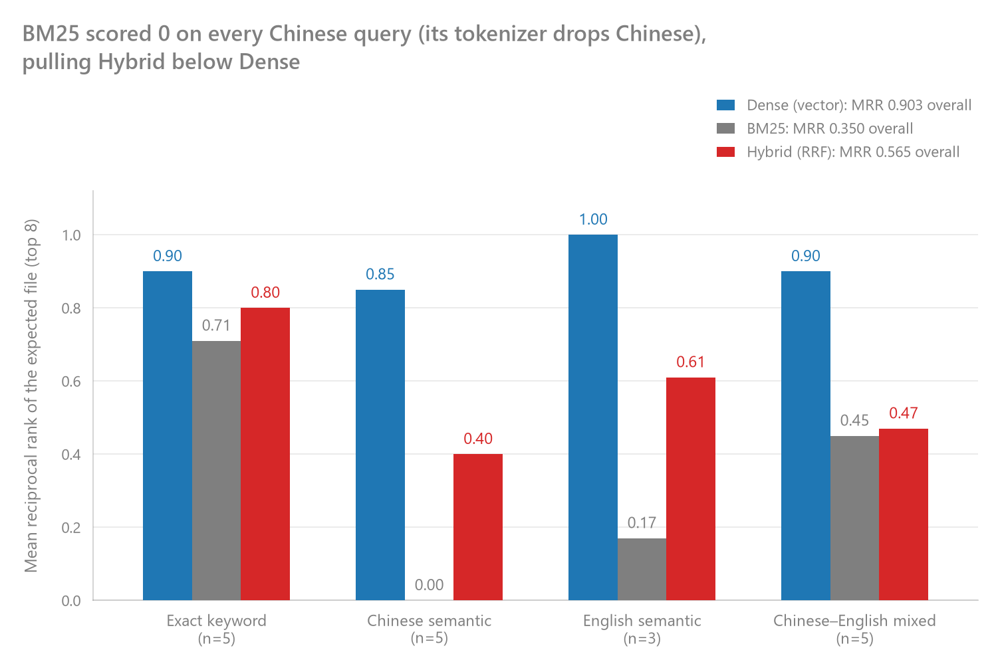
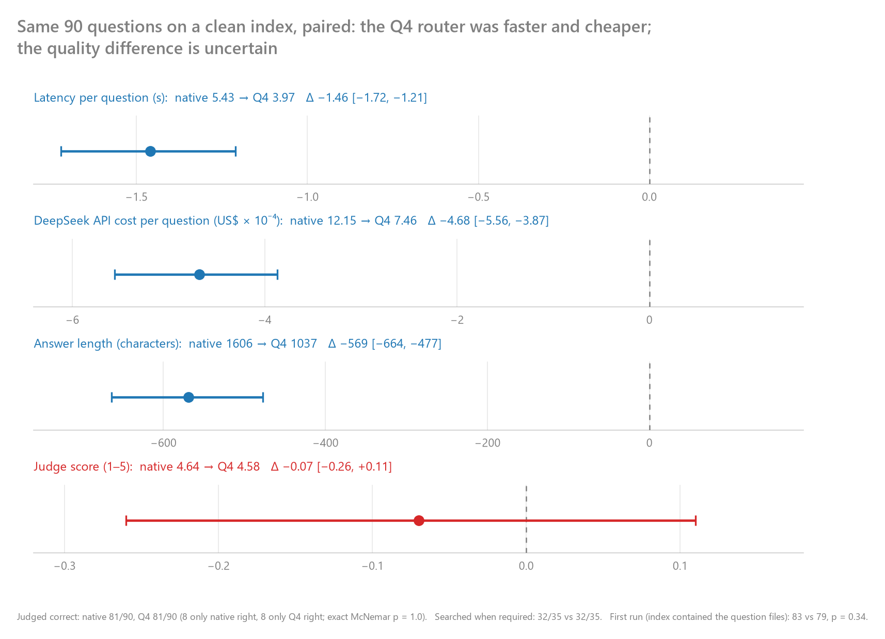
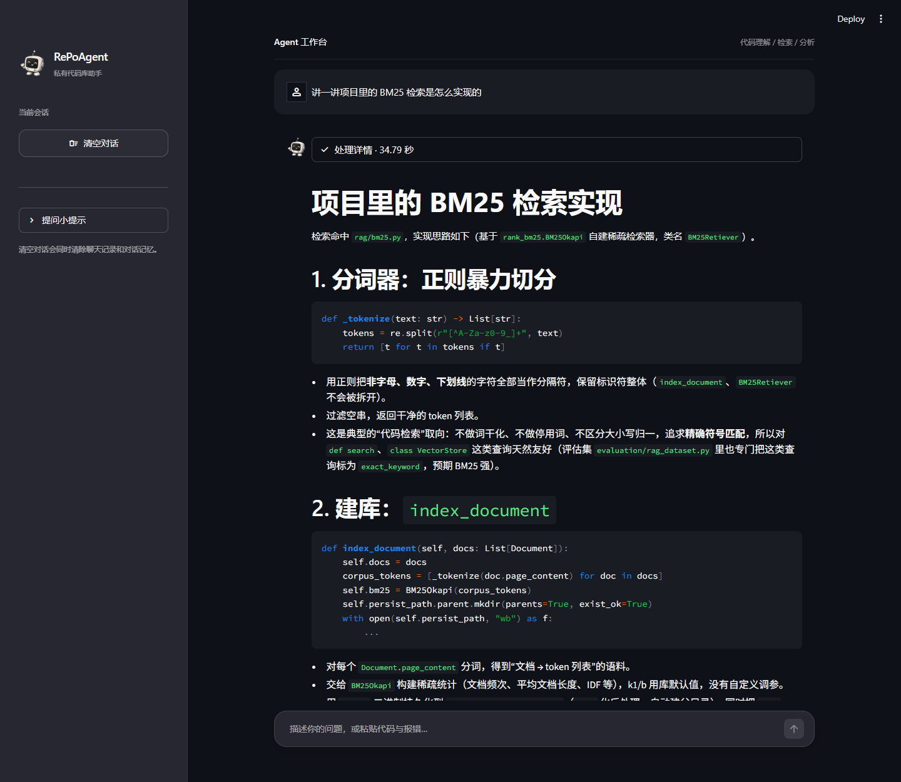

# RepoRouter - 面向代码仓库的AI研发助手

**判断要不要翻代码 → 检索 → 回答 → 评测**

[快速开始](#快速开始) · [代码入口](#代码入口) · [实验报告与原始数据](#数据在哪里)

[早期演示：让它讲讲项目里的 BM25 检索是怎么实现的](#我的早期实践手写-agent-循环和-rag) · [微调过程](#路由小模型是怎么训出来的) · [课程知识对照表](#为这个项目学了什么)

[](https://github.com/Mrch1io/RepoRouter/actions/workflows/ast_ci.yml)
[](requirements.txt)
[](src/api/routes.py)
[](web_ui.py)
[](src/rag/vectorstore.py)

[](src/agent/llm.py)
[](lora/autodl/train_qwen35_4b.yaml)
[](src/agent/router.py)

**语言 / Language**: [English](README.md) | 简体中文

## 一页看懂

**目标**：让代码助手先判断一个问题要不要翻代码，再去检索和回答。做判断的是我用 LoRA 微调的 4B 小模型，项目名里的 Router 就是指它。

**最站得住的结果**：在从没用过的新仓库 nanochat 上（60 道题），补题前的路由模型三次训练答对 41 / 45 / 41 题，补了 140 道边界题后升到 52 / 55 / 55 题。这两组训练和推理时都不带仓库简介，只差补没补题；实际部署的 v2 训练时带简介、推理时也给简介，是 55 / 56 / 50。只加训练步数、不补题的那一次，还是 41 题。

**我做了三件事**：

1. **微调了一个 4B 路由模型**：自己造训练数据（497 → 637 条），用 LoRA 训练，再量化成 GGUF 部署（简称 Q4）。这里的百分比代表“要不要查代码”（查 / 不查 / 先追问）判对的比例：v1 在 50 道同分布题（和训练题出自同一个生成器）上有 98%，换到 87 道人工写的本仓库问题只有 81.6%，和没微调的原版（80.5%）差不多，说明它学会的是出题风格，不是判断本身；补了 140 道边界题的 v2 到 95.0%（3 个 seed 平均），和 9B 原版、DeepSeek Flash 处在同一水平。接进系统后，和让 DeepSeek 自己决定查不查的原生链路相比，90 道端到端题两边都被评委判对 81 道，Q4 每题快约 1.5 秒、回答侧费用少约 39%。（[训练过程](#路由小模型是怎么训出来的) · [研究 2](#2-4b-小模型能学会什么时候该查代码吗) · [研究 4](#4-把-4b-路由接进系统值不值)）
2. **搭了 RAG 并逐项评测**：切块、嵌入、向量检索、BM25 混合检索、重排、软熔断。复核评测结果时，我发现两个会让结果失真的问题：一是 BM25 的分词规则只认英文和数字，中文问题切完一个词都不剩，根本检索不到；二是存放考题的文件被建进了检索库，检索时可能直接搜到题目本身，相当于“开卷考试”。两处都修好后重新评测，下文都以修正后的结果为准。（[研究 3](#3-混合检索真的比纯向量检索好吗) · [问题 7](#7-考题混进了被检索的代码库)）
3. **做了一套信得过的评测**：路由、检索、回答三层分开测；先跑关键词规则、找相似题这些廉价基线，新仓库的题冻结后只评一次；逐题配对、带置信区间，再人工盲评抽查自动评委。（[研究 2](#2-4b-小模型能学会什么时候该查代码吗) · [研究 5](#5-我的评测本身可信吗)）

**五个问题的结论**：

| 问题                                           | 结论                                              | 决定                    |
| -------------------------------------------- | ----------------------------------------------- | --------------------- |
| [能不能只靠检索距离判断要不要查代码？](#1-能不能只靠检索距离判断要不要查代码)   | 不能：挡得住明显无关的题，挡不住听起来像本仓库的题                       | 软熔断默认关闭，交给路由判断        |
| [4B 小模型能学会什么时候该查代码吗？](#2-4b-小模型能学会什么时候该查代码吗) | 能，简单的规则和找相似题都比不上它；但只用生成器出的题训练，学不会                    | 采用 v2，推理时带仓库简介        |
| [混合检索真的比纯向量检索好吗？](#3-混合检索真的比纯向量检索好吗)         | 没有更好：先是更差，修好分词也只是追平；有用的是重排                      | 在线只用纯向量，重排列入[下一步](#未来改进方向)        |
| [把 4B 路由接进系统，值不值？](#4-把-4b-路由接进系统值不值)        | 确定更快更省，质量没测出差别                            | 默认走原生链路，有显卡时可选 Q4      |
| [我的评测结果可信吗？](#5-我的评测本身可信吗)                   | 有参考价值，但我认为评委偏宽松，自动评分可能偏乐观；已经发现的数据和题集问题都已修复。 | 分数照样列出，但写成“被评委判对 81 道”，不说“准确率 90%” |

## 为什么做

写代码最烦的两件事：一是自己写文档，二是接手别人没有文档的代码。更麻烦的是，代码天天在变，文档却很难同步更新，最后不是文档过时，就是开发者不得不反复补文档。做这个项目的初衷其实很简单粗暴：我想让大模型接手这部分最枯燥的苦力活，尝试根据代码自动生成文档，并尽可能降低后续维护成本。最理想状态就是：代码动，文档自动跟上。

第一版做出来后才发现，它连“如何在 Python 中读取一个 txt 文件？”这种问题也要先翻一遍代码库：50 道和代码无关的问题里，有 32 道都去检索了（[记录](data/e2e_eval_log.jsonl)）。要让模型照着代码写文档，它得先知道哪些问题必须翻代码、哪些靠通用知识就能回答，光这一步就很烧脑。于是我把重点转向了一个更具体的问题：**助手什么时候该读代码、该用哪个工具**，并用 LoRA 微调一个 4B 小模型来做这个判断。它在和训练题同一来源的测试题上拿到 98%，换成 87 道人工写的本仓库问题，就只剩 81.6%。从那以后，这个项目都在回答同一个问题：这个分数到底能不能信？“代码动，文档自动跟上”目前还没有实现，我把它留在了[未来改进方向](#未来改进方向)。

## 效果展示

### 一次完整的问答



### 小模型怎么判断要不要查：5 道真实题目

看小模型在 5 道真实问题上怎么判断要不要查代码：前两道都提到 FastAPI，一道要查、一道不用查；最后一道是它判错的。

<sub>题目来自 90 题端到端评测的第二轮，索引已排除考题文件；由 Q4 判断要不要查，DeepSeek Flash 写回答。耗时是整道题从提问到回答的时间，费用只算回答侧的 DeepSeek 调用。</sub>

| 问题                                     | 小模型的决定                                                             | 发生了什么                                                                                     | 耗时 / 费用           |
| -------------------------------------- | ------------------------------------------------------------------ | ----------------------------------------------------------------------------------------- | ----------------- |
| FastAPI 聊天接口挂载在哪个路由下面？                 | `tool_call`：`search_codebase("chat_endpoint FastAPI router path")` | 取回的前 3 段来自 `api/routes.py` 和 `main.py`；评委判正确                                              | 2.17 秒 / $0.00090 |
| 如果要在 FastAPI 里注册一个新路由，通常该怎么写？          | `no_tool`                                                          | 同样提到 FastAPI，问的却是通用写法，直接回答；评委判正确                                                          | 2.77 秒 / $0.00053 |
| 多轮对话记忆裁剪 `_prune_memory` 会丢掉什么消息？      | `tool_call`：`search_codebase("_prune_memory 记忆裁剪 保留哪些消息")`         | 取回的前 4 段都来自 `agent/core.py`；评委判正确                                                         | 3.56 秒 / $0.00061 |
| 什么是 BM25？                              | `no_tool`                                                          | 通用概念，直接回答；评委判正确                                                                           | 4.02 秒 / $0.00070 |
| `search_codebase` 工具返回给模型的 JSON 结构是什么？ | `no_tool`（判错了）                                                     | 回答模型说要先检索，在正文里写了一句“（调用工具：search_codebase …）”，又承认自己“当前无法实际执行工具调用”，请用户允许它去检索；问题没有回答，评委给 2 分 | 2.45 秒 / $0.00030 |

<sub>[回答](data/v2/clean90/e2e_q4.jsonl) · [评分](data/v2/clean90/judge_q4.jsonl)。前两行是同一个关键词 FastAPI，一道要查、一道不查，这正是路由模型要学的边界。最后一行是还没解决的问题：小模型把一道问工具本身的题判成了不用查；回答模型的系统提示又要求“该查就必须调用工具”，可这条链路根本没给它工具，它只好把“调用工具”写成文字。90 道题一共跑了 5 次，这道题每次都漏查。解决分两头：回答这边已经换了单独的系统提示，要求没有检索结果时如实说明、不要假装调用工具；路由这边下一步给训练集补一批问助手自身工具和路由格式的题。</sub>

## 📖 功能一览

主要能力：

- **路由判断（核心）** - 先判断一个问题要不要翻代码、该用哪个工具：可以让 DeepSeek 自己判断，也可以交给我用 LoRA 微调、再量化成 GGUF 的 Qwen3.5-4B 小模型（Q4）
- **检索增强生成（RAG）** - 把代码切块、转成向量存进 Chroma，提问时取回最相关的几段交给模型回答；任意本地仓库都能建索引，Python 文件可以按语法树切块
- **6 个可调用工具** - 代码检索、静态分析、代码补全、日志分析、Dockerfile 生成、单元测试生成
- **评测体系** - 路由、检索、回答三层分开测；每道题记录耗时和费用，小样本结论带置信区间
- **工程体系** - FastAPI 接口 + Streamlit 网页 + GitHub Actions

**适用场景**：读懂陌生代码库、问答仓库里的实现细节、代码质量检查、日志排错、生成 Dockerfile 和单元测试

<details>
<summary>展开看全部功能：判断、检索、工具</summary>

### 判断：要不要翻代码

- 🧭 **两条路由链路可切换**：原生链路（native）让 DeepSeek 自己决定调不调工具；小模型路由（`phase2a`）用我 LoRA 微调的 Qwen3.5-4B 先输出一行路由 JSON（`tool_call` / `no_tool` / `clarify_needed`，加上工具名和参数），大模型只负责写回答；微调后的模型量化成 GGUF Q4_K_M，用 llama.cpp 在本地部署（训练数据、两轮微调和评测见[研究 2](#2-4b-小模型能学会什么时候该查代码吗)）
- 🔁 **防止原地踏步**：模型有时会用同样的参数反复调用同一个工具，结果一样，只是白白浪费时间和钱。现在同一个工具配同样的参数只执行一次，再调用就提醒它“已经查过了，信息够就回答，不够就换个关键词”；一个问题最多来回 5 轮，超过就停下
- 🛡️ **执行前校验**：工具名不在工具表里，或者参数缺失、类型不对、超出范围，就不执行，把原因交回给模型
- 🧠 **多轮记忆**：滑动窗口只保留问题和最终回答，工具的中间结果用完就从记忆里删掉

### 检索增强（RAG）：先找到相关代码，再回答

- 🔍 **向量检索**：把每段代码转成一串数字存进 Chroma（qwen3.7 嵌入，1024 维），提问时找意思最接近的几段。另外还实现了“关键词检索（BM25）+ 两路结果合并（RRF）”和“重排模型再排一遍”，评测时可以打开对比
- ✂️ **两种切块**：默认按字数切，简单，但可能把一个函数从中间切开；也可以按 Python 的语法结构切（AST），优先保留完整函数和类；过大的函数继续拆分，并补上所属类和函数的上下文，行号仍对应原始代码
- 🛑 **软熔断与查询改写**（可选，默认关闭）：最相近代码块的距离超过阈值，就不把检索结果交给模型
- 📦 **任意本地仓库都能建库**：运行 `build_knowledge_base.py --repo-path 仓库路径` 就能给本地任何仓库建索引

### 工具

- 🔬 **analyse_code**：AST 静态分析（可变默认参数、裸 except、函数过长、圈复杂度、未使用的 import）；往 main 推送或提 PR 时，GitHub Actions 也用它扫描本仓库
- 🧪 **generate_tests**：生成 pytest 测试后真的跑一遍，没通过或覆盖率不到 80% 就带着报错重写
- 🪵 **analyse_log**、🐳 **generate_dockerfile**、⌨️ **complete_code**

</details>

### 界面

<details>
<summary>展开看网页和接口</summary>

- **网页**（[网页入口](web_ui.py)，Streamlit）：聊天窗口下面有一个可展开的状态面板，逐条列出这道题里发生了什么：小模型的派单结果（走小模型路由时）、调用了哪个工具、命中了哪些文件（AST 索引还带行号）、有没有触发软熔断，最后给出耗时和估算花费。
- **接口**（[接口入口](src/main.py)，FastAPI）：`POST /api/v1/chat` 按 `session_id` 区分会话；`/api/v1/analyse-code`、`/api/v1/generate-dockerfile`、`/api/v1/log-analyse` 直接调用单个工具；`/docs` 是自动生成的接口文档。

</details>

### 架构



## 路由小模型是怎么训出来的



每一步怎么做、用到了哪些课程知识：

| 步骤       | 我的做法                                                                                                | 对应的CS336课程知识                                                                                  |
| -------- | --------------------------------------------------------------------------------------------------- | --------------------------------------------------------------------------------------------- |
| 造数据      | Gemini 按虚构的内部项目 ModelHub-Serve 出题，保证模型不会事先见过它；规则清洗 + 人工复核，改了 9 条标签、删了 3 条重复，得到 v1 的 497 条           | 用规则过滤低质量文本，用哈希找出重复内容。这里规模要小得多：清洗器按规则检查字段、标签和参数，拿不准的标出来自己看，重复的问题直接删掉                           |
| 补数据      | v1 换到本仓库只有 81.6%，照着错题补了 100 道“问的是项目里的类和函数、却没明说要查代码”的题和 40 道“带项目术语的通用题”，v2 共 637 条                               | 照着错题补数据，是在这个项目里摸索出来的                                                                          |
| 对话模板     | `qwen3_5_nothink`，训练和推理都关掉“思考”，直接输出一行路由 JSON                                                        | SFT 和评测时，问题都套进同一个提示模板再交给模型；训练和推理的格式一旦不一致，模型看到的就是另一种输入                                         |
| 只在回答上算损失 | 日志里那条 v2 样本有 1135 个 token，只有最后 56 个（路由 JSON + 结束符）计入损失，提示词部分全部屏蔽                                    | 把提示和回答拼在一起分词，用 response mask 只在回答的 token 上算交叉熵，提示部分不参与训练；LLaMA-Factory 默认也是这样                 |
| 参数高效微调   | LoRA：r=16、α=32、dropout 0.05，加在所有线性层；冻结视觉编码器；可训练参数只占 0.71%                                           | 课外延伸学习：LoRA 冻结原模型，只在线性层旁边加两个低秩矩阵，学习权重的改变量；要训练的参数少了，优化器状态占的显存也跟着变小                             |
| 优化器与学习率  | AdamW，学习率 1e-4，前 10% 的步数 warmup，之后 cosine 衰减，训练 3 个 epoch                                           | 从零实现 AdamW（一阶、二阶矩估计，加上解耦的权重衰减），以及“先线性 warmup、再按余弦曲线降下来”的学习率调度                                 |
| 显存       | batch 2 × 梯度累积 4（等效 batch 8）；batch 4 时一份 logits 约 8.1 GB，爆显存（[问题 5](#5-4b-模型配-32gb-显卡batch-4-却爆显存)） | 估算参数、激活、梯度和优化器状态各占多少显存；把一个 batch 拆成几个微批次，梯度累加后再更新一次，效果等同于大 batch                              |
| 精度       | bf16 训练                                                                                             | 混合精度训练让矩阵乘法用 bf16 算，省显存、提速度，容易出数值问题的地方仍用 fp32；算交叉熵时 logits 会转回 fp32，这也是问题 5 里 logits 那么占显存的原因 |
| 量化与部署    | LoRA 合并回基座，转成 GGUF Q4_K_M（2.52 GiB），用 llama.cpp 起成 OpenAI 兼容服务；87 道本仓库题上，bf16 和 Q4 都答对 82 道         | 课外延伸学习：把权重从 16 位压到 4 位左右，模型变小，推理时要读的数据也少；Q4_K_M 是混合量化，部分较敏感的权重保留 6 位                          |
| 评测       | 50 道同分布、87 道本仓库、60 道新仓库（nanochat）；每个条件训练 3 次                                                        | UW 机器学习：测试集只在最后用一次，所以新仓库的 60 道题冻结后只评了一次；每个条件训练 3 次，是为了看清 seed 带来的波动                           |

<sub>[训练配置](lora/autodl/train_qwen35_4b.yaml) · token 数见 [v2 训练日志](data/v2/logs/v2/train_4b_v2.log) · 量化前后的成绩见 [bf16 日志](data/v2/logs/v2/lora4b_v2_ood_eval.log) 和 [Q4 日志](data/v2/logs/v2/route_ood_gguf_Q4_K_M.log) · 数据构建的完整记录见[数据构建报告](评估/第二版/02-数据构建.md)。</sub>



<sub>seed 43 和 44 各训练一次的训练损失，只算路由 JSON 的 token。两版的曲线几乎重合，泛化却差了一截：训练损失看不出能不能泛化，要换一批没见过的题去测，见[研究 2](#2-4b-小模型能学会什么时候该查代码吗)。</sub>

## 评测设计：每套题只回答一个问题

| 题集            |        条数 | 用来回答                      | 文件                                                                          |
| ------------- | --------: | ------------------------- | --------------------------------------------------------------------------- |
| 路由训练集 v1 / v2 | 497 / 637 | （训练用）                     | [v1](lora/routing_train_v1_no_summary.json) · [v2](lora/routing_train.json) |
| 同分布路由测试       |        50 | 模型学会这批数据了吗？               | [同分布测试集](lora/eval_in_domain.json)                                          |
| 本仓库开发／验证集     |        87 | 真实仓库里还会判断吗？迭代时用来找问题、定补题方向；就是下面 90 道端到端题去掉 3 道“查不查都算对”的题 | [本仓库验证集](lora/eval_cross_repo.json)                                         |
| nanochat 冻结测试 |        60 | 换到一个没见过的真实仓库，还会判断吗？       | [nanochat 冻结题](data/v2/newrepo_nanochat60/questions_frozen.jsonl)           |
| 检索题           |        18 | 期望的源文件排第几？                | [检索题集](src/evaluation/rag_dataset.py)                                       |
| 距离题           |        90 | 检索距离能不能分开该查和不该查？          | [距离题集](src/evaluation/soft_fuse_dataset.py)                                 |
| 端到端题          |  和距离题是同一批 | 完整回答对不对、多快、多贵？            | [标准答案](src/evaluation/e2e_manifest.py)                                      |

- **三层分开测**：路由决策、检索证据、最终回答各用各的题和指标，不合并成一个“准确率”。
- **失败计入分母**：模型输出解析失败算错，不从分母里删掉。旧评测代码在解析失败时提前返回，曾把 27/31 算成 27/30，改正后加了回归测试（[解析失败仍计入分母](tests/test_routing_metrics.py)）。
- **离线复现**：路由训练集和测试集不联网就能逐条重建并比对。
- **每道题记账**：耗时、token、DeepSeek 缓存命中和估算费用都按题记下来。
- **小样本也要带区间**：Wilson 区间、bootstrap 区间、McNemar 精确检验（[统计方法](src/evaluation/stats.py)）。
- **出题、答题、判卷三家分开**：Gemini 生成训练题，DeepSeek 回答，Qwen 当评委；最后按事先定好的抽样规则做人工盲评。

## 我研究了什么：用证据决定做不做

五个问题的结论总览见[一页看懂](#一页看懂)。完整结果表与原始记录集中在[第二版评估目录](评估/第二版/README.md)。

### 1. 能不能只靠检索距离，判断要不要查代码？

- **实验设置**：90 道题（40 道要查本仓库，50 道不用查），每道都强制检索一次，看最相近的代码块离问题有多远，太远就拦下不查。先规定 40 道该查的题最多误拦 3 道，再在这个限制下找拦得最多的阈值；字符 / AST 两种切块、标准 / Flash 两种嵌入分别测。
- **结论：不能单靠距离。它挡得住明显无关的题，挡不住“听起来像本仓库”的题。**
  - 明显无关的通用题，比如“如何在 Python 中读取一个 txt 文件？”，几乎都能拦下：28 道里拦下 25～28 道。
  - 带项目术语的通用题只拦下一半（12 道里 5～6 道），故意误导的边界题只拦下 2～4 道（共 10 道）。仓库里正好有 `bm25.py`，所以“什么是 BM25？”离代码的距离，比大多数本仓库题还近。
  - 合起来，默认的字符切块 + 标准嵌入拦下 33/50，最好的 AST + 标准嵌入拦下 36/50。
- **决定**：软熔断只做可选的兜底，默认关闭；要不要查代码交给路由模型判断（[研究 2](#2-4b-小模型能学会什么时候该查代码吗)）。



<sub>字符＋标准嵌入的干净索引；竖线右侧被拦截，误伤 3/40、拦下 33/50。完整设置、八组基线和失败复现记录见[检索与软熔断报告](评估/第二版/04-检索与软熔断.md)。</sub>

> [!TIP]
> **从中学到**：
> - AUC 衡量的是所有阈值上的整体能力；部署时只能选一个阈值，真正得到的是那个点上的拦截率。
> - 先定能接受的误伤，再选阈值。要是先看结果再挑阈值，总能挑出一个好看的数字。
> - 阈值是在同一批 90 道题上选出来、又在上面统计的，结果偏乐观，还需要独立的题集验证。
>
> **应用知识**：
> - Imperial 的 Mathematics for Machine Learning 讲过内积、距离和夹角的关系：单位向量的平方距离等于 2 − 2cosθ，所以阈值 0.905 就是“最相近代码块的余弦相似度低于约 0.55 就拦截”。（数学真好玩）
> - UW 机器学习的分类课讲过精确率和召回率此消彼长，误报代价高时要优先保证精确率，所以这里先给误伤设上限。这和漫画翻译项目里“拿不准就不合并”是同一个思路：误合并会把两个人的话混成一句，漏合并最多译得生硬。

<details>
<summary>展开看推导：距离怎么换成余弦，为什么先限误伤</summary>

- ‖a − b‖² = ‖a‖² + ‖b‖² − 2⟨a, b⟩。库里的向量都是 1024 维的单位向量，‖a‖ = ‖b‖ = 1，所以平方距离 = 2 − 2cosθ。Chroma 默认用平方 L2 距离，阈值 0.905 对应 cosθ = 1 − 0.905 / 2 ≈ 0.55。距离和余弦只是同一个量的两种写法。
- 这里“拦下”就是报阳性：把该查的问题拦下（误伤），回答就完全没有代码依据；放过一道无关题，代价只是模型多看几段不相干的代码，相对小一些。所以先给误伤设上限，再在上限之内争取拦截率。

</details>

### 2. 4B 小模型能学会“什么时候该查代码”吗？

- **实验设置**：任务和 3 月一样：给一个问题，模型只输出一行路由 JSON，说明要不要查代码、用哪个工具、参数是什么。用重新生成并复核的 497 条数据训练 v1；v2 补了 140 道边界题，并在每条样本前加上仓库简介。先在 50 道同分布题和 87 道本仓库题上测，再用三个 seed 做消融和只加步数的对照，最后在 nanochat 的 60 道冻结题上验证。训练细节见上面的[路由小模型是怎么训出来的](#路由小模型是怎么训出来的)。
- **结论：能学会，但只靠生成器出的题学不会。**
  - **廉价方法替代不了**：先看不训练模型的办法。关键词规则在 87 道本仓库题上对 70.1%，nanochat 上 71.7%；在训练题里找最像的 5 道投票，同分布题上有 82%，换到本仓库题只剩 44.8%，比全部回答“不查”（59.8%）还低（它常把题误判成“需要追问”，只看查不查也只有 69.0%）。作为对照，没微调的 4B 原版在本仓库题 / nanochat 上是 80.5% / 65.0%，v2 不带简介（三个 seed 平均）是 92.0% / 83.9%。（[廉价基线结果](data/v2/cheap_baselines/run.json)）
  - v1 在 50 道同分布题上答对 49 道，换到 87 道本仓库题只有 81.6%，和没微调的 4B 原版（80.5%）差不多；该查代码的 35 道题里它只查了 19 道，比原版的 26 道还少。它学会的是生成器的出题风格，不是判断本身。
  - 补了 140 道边界题的 v2，三个 seed 平均 95.0%，和 9B 原版、DeepSeek Flash 处在同一水平（同分不代表能力相同）。
  - 换到从没用过的 nanochat，补题的效果仍然成立。推理时都不给仓库简介：v1 三个 seed 是 41 / 45 / 41，只补题、训练时也不带简介的版本是 52 / 55 / 55，两组没有重叠；只加训练步数的那次仍是 41。
  - nanochat 上推理时给简介：v2 是 55 / 56 / 50，原版 4B 是 48，DeepSeek Flash 和 V4 Pro 都是 55。能迁移到新仓库，但 seed 之间最多差 6 道，仍有波动。
- **决定**：采用 v2，推理时提供仓库简介。



<sub>首轮 v1/v2：50 道同分布题与 87 道本仓库题，横线为 Wilson 95% 区间。</sub>



完整数据流程见[数据构建](评估/第二版/02-数据构建.md)；各条件、三个 seed、步数与 nanochat 对照见[路由微调报告](评估/第二版/03-路由微调.md)。

> [!TIP]
> **从中学到**：
> - 同分布的高分只能说明模型学会了这批数据。训练题和测试题出自同一个生成器时，分数会系统性偏高。
> - 先跑最便宜的基线，才知道复杂方案值不值。找相似题在同分布题上很准，换个仓库就不如“全部不查”，说明它只是记住了训练题的样子，和 v1 犯的是同一种错。
> - 一次只改一个条件，才说得清功劳在谁。v2 同时改了数据和简介，消融才把两者拆开；加数据又顺带改了训练步数，所以还要补一组只加步数的对照。
> - 一次训练的分数不能直接当结论：v1 换个 seed 就是 69～73，v2 在新仓库上是 50～56。条件之间差一两道题时，先和 seed 之间的波动比一比。
> - 训练时每条样本带的都是同一段简介，我原以为模型会学着忽略它。结果正相反：在 87 道本仓库题上，推理时去掉简介，三个 seed 都少对 1～4 道，说明它在用这段简介。推理时都不给简介的话，87 道题上训练时带不带简介平均分差不多（92.0% 对 92.7%）；到了 nanochat，训练时带简介的 v2 反而少对 11 道（三个 seed 合计 151 对 162）。训练时带了简介，推理时最好也给上。
>
> **应用知识**：
> - UW 机器学习的回归课讲模型选择时强调，测试集只能在最后用一次。这 87 道题在 v1 和 v2 之间被我用来找问题、定补题方向，严格地说已经变成了验证集。所以我又给一个从没用过的仓库手写了 60 道题，冻结后只评一次。
> - CS336 作业 5 手写 SFT 时，用 response mask 只在回答上算损失。这里也一样：v2 一条样本 1135 个 token 里只有 56 个参与训练，模型练的只是“该输出哪条路由 JSON”，提示词本身不进损失。

### 3. 混合检索真的比纯向量检索好吗？

- **实验设置**：检索库是本项目自己的 `src/` 目录，字符切块后不到 90 块（旧索引 87 块；②③ 的干净索引 75 块，是代码改过之后重建的）。18 道检索题，分四类：精确关键词、中文语义、英文语义、中英混合。看期望的源文件在前 8 条结果里排第几，用 MRR 打分：排第 1 记 1 分，排第 2 记 0.5 分，排第 3 记 1/3 分……最后取平均，越接近 1 越好。比较三种检索：纯向量（Dense）、关键词（BM25），以及把两份排名按名次合并的混合检索（Hybrid）。
- **结论：没有更好。我原以为融合会更强，结果它先是明显更差，修好以后也只是追平；真正把分数提上去的是重排。**

| MRR | Dense | Hybrid |
|---|---:|---:|
| ① 一开始（旧索引） | 0.903 | 0.565 |
| ② 中文分词修好前（干净索引） | 0.944 | 0.838 |
| ③ 汉字按单字切开后（同一个干净索引） | 0.944 | 0.935 |
| ④ 多取 24 条候选，再用重排模型排出前 8 条（旧索引） | 1.000 | 1.000 |

<sub>只在每一行里面比较。①④ 和 ②③ 用的不是同一个索引，不能跨行相减。</sub>

- **为什么一开始更差**：按题型拆开才看出来（见下图）。BM25 的分词正则只认英文和数字，5 道中文题分完一个词都不剩，所有代码块都是 0 分，BM25 只能原样返回索引最前面那几块；合并排名时，这几块无关的代码又被混进了结果。只看这 5 道中文题，Hybrid 0.402，Dense 0.850。
- **修好之后**：把汉字按单字切开，Hybrid 从 0.838 升到 0.935，和 Dense 的 0.944 差不多。只有 18 道题，分不出这点差距，只能说追平了。
- **决定**：在线检索继续只用纯向量，混合检索不上线；重排效果最好，但只在旧索引的 18 道题上离线验证过，接进在线检索放在[未来改进方向](#未来改进方向)。



<sub>按题型拆开的 MRR（旧索引，字符切块 + 标准嵌入）：中文题上 BM25 全是 0 分，把 Hybrid 拖到了 Dense 下面。完整对照见[检索报告](评估/第二版/04-检索与软熔断.md)。</sub>

> [!TIP]
> **从中学到**：
> - 融合不会自动变好。RRF 按名次把两份排名合在一起，默认两份都有参考价值；其中一份是乱排的，合起来反而冲淡了好结果。
> - 平均数会藏住“某一类全错”：0.565 看不出问题，按题型一拆就清楚了。
> - 每道题取回的都是同一批块，说明分数全一样：旧代码用的 `sorted` 是稳定排序，平局时保持原来的顺序，于是总是索引最前面那几块。
> - 检索库只有七八十块、18 道题，又只看文件有没有命中，结论适用的范围很窄，换到大仓库要重新测。
>
> **应用知识**：
> - CS336 写 BPE 分词器时，第一步是用正则做预分词，GPT-2 的模式用 `\p{L}` 匹配任何语言的字母。我原来的 BM25 正则只认 ASCII，中文在这一步就被整个丢掉了。
> - UW 机器学习的检索课讲 TF-IDF：在这篇文档里出现得多、在别的文档里出现得少的词更重要。BM25 是它的改进版，但前提是先把词切出来。

### 4. 把 4B 路由接进系统，值不值？

- **实验设置**：把 v2 量化成 Q4_K_M，用 llama.cpp 起成路由服务，DeepSeek Flash 只负责写回答；对照组是让 Flash 自己决定调不调工具（原生链路）。同一批 90 道题，两条链路各答一遍，逐题配对比较，由自动评委判对错。一共跑了两轮：原索引一轮，排除考题文件后的干净索引再一轮（见[问题 7](#7-考题混进了被检索的代码库)）。
- **结论：更快、更省 API 费用是确定的；质量上没测出差别，但 90 道题也证明不了两边一样好。**

| 干净索引这一轮，每题平均 | 原生链路 | Q4 路由 |
|---|---:|---:|
| 判为正确 | 81/90 | 81/90 |
| 耗时 | 5.43 秒 | 3.97 秒 |
| 回答侧 DeepSeek 费用 | $0.00121 | $0.00075 |
| 回答长度 | 1606 字 | 1037 字 |

- **更快、更省**：Q4 每题快约 1.5 秒（95% 区间 1.2～1.7 秒），回答侧费用少约 39%，两轮都是这个方向。省下的不全是路由的功劳：Q4 链路平均只调用 DeepSeek 0.98 次（原生 1.36 次），回答也短了三分之一。
- **质量没测出差别**：干净索引这一轮两边都答对 81 道，你对我错、我对你错的各 8 道，正好打平；第一轮是 83 比 79，差距也不显著（McNemar p = 0.34）。
- **账没算全**：费用只比了回答侧的 DeepSeek 调用。Q4 链路还需要一张显卡跑路由模型，原生链路不需要，这部分没算；要专门为它开一张显卡的话，省下的 API 费用未必抵得过。
- **两边都不是第一次见这批题**：这 90 道题去掉 3 道“查不查都算对”的，就是研究 2 里的 87 道本仓库题；v2 补什么题，正是照着 v1 在这 87 道上的错题定的。原生链路的系统提示也是 3 月在这 90 道题上调出来的（检索误调从 33 道降到 2 道，见[提示词复测记录](archive/early-experiments/评估/09-提示词优化复测.md)），里面举的“什么是快速排序”“FastAPI 路由怎么注册”“什么是 BM25”就是其中 3 道。所以这里只能算开发集上的对比，两条链路在新仓库上的完整回答还没测（见[未来改进方向](#未来改进方向)）。
- **决定**：默认仍走原生链路，Q4 路由做成可选模式（`routing_backend=phase2a`）。



各轮结果、部署开销与配对区间见[量化与系统接入报告](评估/第二版/05-量化与系统接入.md)。

> [!TIP]
> **从中学到**：
> - 系统级的比较要配对：同一道题让两条链路各答一次，比两组平均数各说各话可靠得多。
> - 同一套设置跑两次，原生链路的检索数就差了 2 道。看到单次运行里两三道题的差距，先拿它和重复运行的波动比一比。
> - 漏查的那道题（[效果展示](#效果展示)最后一行）暴露的是职责冲突：当时共享的系统提示要求“该查就必须调用工具”，小模型路由链路却不给回答模型工具清单。一个模型能做什么，要同时写进提示词和接口。
> - 两条链路按固定顺序运行，缓存、API 负载和时段都可能影响耗时，这些混杂没有被消除。
>
> **应用知识**：离散数学的组合与概率：McNemar 精确检验只看两条链路结论不同的题。如果两边其实一样好，这些题谁对谁错就像抛硬币，p 值就是二项分布两头的概率。

<details>
<summary>展开看 p = 0.34 怎么算</summary>

第一轮结论不同的有 10 道，比分 3 : 7。出现 3 : 7 或更偏的结果，概率是 2 × (C(10,0) + C(10,1) + C(10,2) + C(10,3)) / 2¹⁰ = 2 × 176 / 1024 ≈ 0.34。干净索引这一轮是 8 : 8，正好对半，按同样的公式算出来超过 1，取上限 1。[McNemar 检验](src/evaluation/stats.py) 就是这样算的。

</details>

### 5. 我的评测本身可信吗？

- **实验设置**：对第一轮 90 题做人工盲评。先按事先定好的规则随机抽 10 道，再加上 11 道自动评委给两条链路判得不一样的题，共 21 道题、42 份答案；答案隐去是哪条链路答的，由我逐份判。另外检查了检索取回的来源，以及训练题和测试题有没有重合。
- **结论：有参考价值，但评委偏宽松，自动评分可能偏乐观；目前已发现的数据和题集问题已修复。**
  - **评委偏宽松**：随机抽的 10 道里，评委判两条链路全对，我看下来各有 1 道（p38）只是部分正确。在 11 道判分有分歧的题里，两条链路各有 9 份答案我判为不完全正确，评委把其中原生链路的 5 份、Q4 的 2 份判成了正确。样本太小，说不清它是否偏向某一边，但自动分数不能直接当准确率。
  - **数据有漏洞**：检索库里混进了考题文件，排除后重跑了一轮（见[问题 7](#7-考题混进了被检索的代码库)）。
  - **题集被用“脏”了**：87 道本仓库题已经在迭代中用过，最终验证改用冻结的 nanochat 60 题（见[研究 2](#2-4b-小模型能学会什么时候该查代码吗)）；50 道同分布题里，还有 1 道和训练题一字不差。
- **决定**：两轮的自动分数照样列出，但写成“被评委判对 81 道”，不说成“准确率 90%”，因为评委偏宽松；人工抽查只看了 21 道，查出来的比例也不拿去推算全部 90 题。

盲评、双评委对照和 p04/p24/m04 错例见[回答质量报告](评估/第二版/06-回答质量与复盘.md)；50 题中与训练集重合的 1 题见[数据构建](评估/第二版/02-数据构建.md)。

> [!TIP]
> **从中学到**：
> - 评测也是代码，也会有 bug，而它一出错，所有结论都会跟着错。
> - 先定抽样规则、再看结果，才能防止自己挑对结论有利的样本；随机抽的题和故意挑出的分歧题要分开统计。
> - 一旦用测试集做过决定，它就不再是测试集。
>
> **应用知识**：CS224N 讲机器翻译评估时指出，BLEU 这样的自动指标和人的判断并不总是一致，所以要人工评估兜底。拿 LLM 当评委也一样。

## 为这个项目学了什么

<details>
<summary>展开看各门课用在了哪里（点链接跳到对应小节）</summary>

| 自学课程 | 学到的 → 用在了哪里 |
| --- | --- |
| CS50x | 哈希表的键要先统一（Speller 查词不分大小写）→ [调用指纹先排序参数再查重](#1-agent-原地踏步同一个工具被反复调用)；Flask 的 session → [按会话隔离对话记忆](#2-多人同时聊天记忆串到了别人的对话里)；check50 自动测试 → [生成的测试要真的跑一遍](#3-生成的单元测试要真的跑一遍) |
| Python for Everybody | 正则与 JSON 解析 → [从模型输出里找出合法的路由 JSON](#6-小模型输出的-json怎么接得住)；也正是一行正则，让 [BM25 丢掉了中文](#3-混合检索真的比纯向量检索好吗) |
| CS336 | 资源核算 → [batch 4 为什么爆显存](#5-4b-模型配-32gb-显卡batch-4-却爆显存)；BPE 之前的正则预分词 → [BM25 分词丢掉中文](#3-混合检索真的比纯向量检索好吗)；SFT 的对话模板 → [训练和推理都关掉“思考”](#6-小模型输出的-json怎么接得住)；手写 AdamW 与 cosine 调度、混合精度、梯度累积、只在回答上算损失 → [路由小模型是怎么训出来的](#路由小模型是怎么训出来的)；数据去重与测试集去污染 → [考题混进检索库](#7-考题混进了被检索的代码库) |
| CS224N | 开放域问答的“检索器 + 阅读器” → [RAG：先检索、再回答](#3-混合检索真的比纯向量检索好吗)；词向量与相似度 → [向量检索与距离阈值](#1-能不能只靠检索距离判断要不要查代码)；自动指标和人工评估的差距 → [LLM 评委要人工抽查](#5-我的评测本身可信吗) |
| Mathematics for Machine Learning | 内积与夹角 → [平方距离 = 2 − 2cosθ，阈值 0.905 约等于余弦 0.55](#1-能不能只靠检索距离判断要不要查代码) |
| UW Machine Learning | 精确率与召回率的取舍 → [先定误伤上限，再选阈值](#1-能不能只靠检索距离判断要不要查代码)；测试集只在最后用一次 → [87 道题已经被我用“脏”了](#2-4b-小模型能学会什么时候该查代码吗)；TF-IDF 检索 → [BM25](#3-混合检索真的比纯向量检索好吗) |
| 课外延伸学习 | LoRA → [只训练 0.71% 的参数](#路由小模型是怎么训出来的)；模型量化 → [Q4 量化后 87 题成绩不变](#路由小模型是怎么训出来的) |
| 离散数学 | 组合计数与二项分布 → [McNemar 精确检验：p = 352 / 1024](#4-把-4b-路由接进系统值不值) |

</details>

## 我遇到的问题

### 1. Agent 原地踏步：同一个工具被反复调用

- **问题**：Agent 有时会用一模一样的参数反复调用同一个工具，一直到迭代上限，3 月的演示录屏里就能看到“检测到重复调用: search_codebase”。最早的拦截只看工具名，又带来了反方向的问题：模型换了关键词想再搜一次，也会被当成重复拦下。
- **做法**：
  - 调用指纹 = 工具名 + `json.dumps(参数, sort_keys=True)`，存进集合；只有工具和参数都相同才拦截（[对话循环](src/agent/core.py)）。
  - 拦下的调用不执行，但仍然回一条 `tool` 消息，提醒模型：信息够了就直接回答，不够就换个关键词再搜。
  - 一轮最多 5 次迭代。到上限就停下，并照样裁剪记忆，不把没配对的工具消息带进下一轮。

<details>
<summary>验证</summary>

- [重复调用与轮数限制测试](tests/test_agent_loop.py)：相同参数的重复调用会被拦下，换参数后照常执行；达到 5 轮后停止。

</details>

> [!TIP]
> **从中学到**：
> - “相同”要先定义清楚：同样的参数换个键的顺序，转成的字符串就不一样了，所以先排序再比较。
> - 拦截不等于不回复：OpenAI 格式的接口要求，assistant 发出的每个 tool_call 都要有一条对应 id 的 tool 回复。拦截消息本身就是给模型的反馈，告诉它下一步该怎么做。
>
> **应用知识**：CS50x 的 Speller 作业要自己写哈希表，而且查词不分大小写：Foo 和 foo 得先统一成小写再算哈希，才会落到同一个位置。调用指纹也是这样，同样的参数只是键的顺序不同，先 `sort_keys` 统一成同一个字符串，才认得出是同一次调用。

### 2. 多人同时聊天，记忆串到了别人的对话里

- **问题**：最早的 FastAPI 接口全局只有一个 RepoRouter 实例，所有用户共用一份对话记忆：A 刚问过的问题，会出现在 B 的上下文里。
- **做法**：按请求里的 `session_id` 各建一个 Agent，第一次用到时才创建；最多保留 100 个会话，超出就删掉最早的（[会话管理](src/api/routes.py)）。接口函数用普通 `def`，FastAPI 会把它放进线程池执行，同步的大模型调用不会卡住其他请求。
- **约束**：同一个会话同时发来两个请求，仍会同时改同一份记忆；费用计数 `USAGE` 是进程级的全局变量，并发时会互相清零。单人演示够用，多人部署之前还要加锁，或改成按请求记账。

<details>
<summary>验证</summary>

- [会话隔离测试](tests/test_api.py)：用两个 `session_id` 各问一句，第二个会话看到的仍是“第 1 问”，说明记忆没有串。

</details>

> [!TIP]
> **从中学到**：状态放在哪里，就决定了隔离到哪一层：模块级变量是整个进程共用，按 `session_id` 的字典是每个会话一份，要做到每个请求一份还得再往下拆。
>
> **应用知识**：CS50x 的 Flask 作业 Finance 用 session 记住每个用户是谁；这里的道理一样，只是要记住的从“登录用户”换成了“对话记忆”。

### 3. 生成的单元测试，要真的跑一遍

- **问题**：`generate_tests` 最初只把模型写的测试原样返回，从来没执行过。后来检查这个工具时才发现，提示词里写成了 `f"\ncode\n"`，被测代码根本没传给模型：它一直在给一段看不见的代码写测试，而且写得还挺像样。
- **做法**（[测试生成实现](src/agent/tools/test_generation.py)）：
  - 被测代码和测试写进临时目录，用子进程跑 pytest，30 秒超时（生成的代码可能有死循环）。
  - 借鉴 qodo-cover：装了 pytest-cov 就同时看覆盖率。没通过，或覆盖率不到 80%，就把 pytest 的输出（包括没覆盖到的行号）交回给模型重写，最多生成 3 次。
  - 装了 pytest-cov 却拿不到 `target.py` 的覆盖率（比如生成的测试根本没导入被测代码），也算没通过，带着提示重写。以前这种情况会被当成“没装 pytest-cov”直接放行。
  - 3 次都不行，就照实返回最后一次的报错，不假装成功。
- **约束**：临时目录加超时不是沙箱。生成的代码用本机 Python 执行，继承当前的环境变量，没有隔离文件和网络。

<details>
<summary>验证</summary>

- [测试生成回归](tests/test_generate_tests.py)：通过和失败都能识别；死循环会在超时后被终止；失败后带着报错重写，直到通过；覆盖率不够时会要求补测试；拿不到覆盖率时会要求重写，3 次都拿不到就算失败；没装 pytest-cov 时仍然只看通过没通过。

</details>

> [!TIP]
> **从中学到**：
> - 模型生成的代码，在运行之前都只是“看起来对”。这个 bug 恰好说明，光看输出很难发现输入错了。
> - “能通过”和“测到了”是两件事。覆盖率给了第二件事一个能检查的标准，但覆盖率高也不代表断言写对了。
>
> **应用知识**：CS50x 每次作业都要先过 check50 的自动测试。这里把同样的要求加给了模型，让它也上上课（笑）。

### 4. 一个空的 `__init__.py`，让向量从 1024 维变成 2560 维

- **问题**：改用语法树（AST）切块后，建库时向量维度对不上：库里是 1024 维，新的一批却是 2560 维。查下来，是空的 `__init__.py` 切出了空块，而 qwen3.7 嵌入接口遇到一批里有空字符串时，会整批返回 2560 维。
- **做法**：嵌入时显式传 `dimensions=1024`（[向量检索](src/rag/vectorstore.py)）；AST 切块跳过只有空白的块（[按语法树切块](src/rag/splitter.py)），同时记下每块的起止行号，检索结果能直接说“第几行”。

<details>
<summary>验证</summary>

- AST 索引里的 110 个块全部是 1024 维；[切块回归测试](tests/test_splitter.py)检查短函数保持完整、大函数分块保留所属上下文，行号能对应原文。

</details>

> [!TIP]
> **从中学到**：接口的默认行为会随输入变化。关键参数（维度）要写死，异常输入（空块）要在源头过滤，两道保险都要有。

### 5. 4B 模型配 32GB 显卡，batch 4 却爆显存

- **问题**：在租来的 RTX 5090（32GB）上用 LoRA 训练 Qwen3.5-4B。按 4B 参数估算，显存应该绰绰有余，但 batch size 设成 4 时，在计算 loss 的时候爆了显存（[训练配置](lora/autodl/train_qwen35_4b.yaml)里留了注释）。
- **做法**：
  - batch 2 × 梯度累积 4，等效 batch 仍然是 8。
  - 只训练 LoRA（r=16、α=32，覆盖所有线性层），冻结模型自带的视觉编码器：可训练参数 32,464,896 个，占全部 4,571,730,432 个参数的 0.71%。
  - 其余训练设置见[路由小模型是怎么训出来的](#路由小模型是怎么训出来的)。

<details>
<summary>验证</summary>

- 训练日志：v2 用 637 条数据训练 240 步，耗时 47 分 35 秒；v1 用 497 条，耗时 36 分 21 秒。可训练参数和词表大小都来自同一份日志。

</details>

> [!TIP]
> **从中学到**：
> - 先算账：logits 的大小 = batch × 序列长度 × 词表大小。Qwen3.5 的词表有 248,320 个词，按截断长度 2048、fp32 算，batch 4 时一份 logits 就要 4 × 2048 × 248,320 × 4 字节 ≈ 8.1 GB，算交叉熵时还要再存同样大小的中间结果和梯度。相比之下，4B 模型的 bf16 权重约 9.1 GB（45.7 亿 × 2 字节）。这是按最长序列算的上限，实际每批只补齐到其中最长的样本。
> - 大词表模型里，输出层这一项随 batch 和序列长度线性增长，很容易比权重本身还大。梯度累积用时间换显存，等效 batch 不变。
>
> **应用知识**：CS336 的第一次作业要手算 Transformer 的参数量，以及激活和优化器状态各占多少显存。这里同样的算法用在了输出层上。

### 6. 小模型输出的 JSON，怎么接得住

- **问题**：路由模型应该只输出一行 JSON，比如 `{"decision_type":"tool_call","tool_name":"search_codebase","arguments":{"query":"..."}}`。但实际输出可能夹带说明文字、代码围栏，或者给出约定之外的决策类型；解析一失败，整轮对话就接不下去。就算解析成功，工具名和参数也可能不合法：以前像 `{"decision_type":"tool_call","tool_name":[]}` 这样的输出，要到执行时查工具表那一步才直接报错。
- **做法**：
  - [路由 JSON 解析](src/agent/router.py) 从每一个 `{` 开始用 `json.JSONDecoder.raw_decode` 尝试解析，只接受 `decision_type` 是字符串、并且属于三种之一的对象。
  - 全部失败就兜底成 `no_tool`，并在 trace 里标上 `parse_failed`，交给大模型直接回答，错误不会被悄悄吞掉。
  - 执行前，[工具执行入口](src/agent/core.py) 先确认工具名在工具表里，再用借鉴 BFCL 写的 [工具参数校验](src/agent/tools/schemas.py) 按工具定义检查参数：必填参数不能缺、不能是空字符串，类型要对，不能有工具定义之外的参数，`top_k` 要在 1 到 50 之间。不合法就不执行，把原因作为工具结果交回给模型，并在 trace 里记下错误。原生和小模型路由两条链路共用这一步。
  - 推理时传 `enable_thinking: False`，和训练时的 `qwen3_5_nothink` 模板保持一致，不让模型先“思考”一大段再输出。

<details>
<summary>验证</summary>

- [路由解析与工具校验测试](tests/test_agent_loop.py)：检查路由 JSON 解析和参数校验；工具名或参数不合法时不执行，并记录错误；合法调用只执行一次。
- 量化后的 Q4 模型在 87 道本仓库题上，输出 87/87 都能解析（[日志](data/v2/logs/v2/route_ood_gguf_Q4_K_M.log)）。
- 两轮 90 题端到端评测都跑在加这一步之前；360 次回答里没有一次工具调用出错，所以它还没在真实运行中拦下过不合法的调用。

</details>

> [!TIP]
> **从中学到**：
> - 解析（parse）和校验（validate）是两步。
> - 兜底要留痕，否则看起来一切正常，其实是在悄悄降级。
> - 训练和推理的对话模板必须一致：模板一变，模型看到的就是另一种输入格式。
>
> **应用知识**：Python for Everybody 解析网络 API 的返回时，用 try/except 包住 `json.loads`，解析失败就跳过这一条；这里多做了一步，把失败记进 trace。CS336 讲 SFT 时，训练和推理也用同一个提示模板。

### 7. 考题混进了被检索的代码库

- **问题**：核对端到端评测的检索记录时，我发现很多题取回的代码块来自 `soft_fuse_dataset.py`。一查才知道，90 道评测题的原文就写在这个文件里，而它和其他代码一起被建进了索引，模型检索时可能直接搜到考题本身。影响有多大：原索引上，90 道题里有 33 道，离它最近的代码块就来自考题文件；第一轮端到端评测中，原生链路 34 次检索有 27 次取回了考题文件，Q4 是 33 次里 21 次，两边加起来有 11 次直接搜到了这道题的原文。
- **做法**：
  - 最省事的办法是把 `src/evaluation/` 整个排除，但我没有这样做。评测脚本也是仓库里的正常代码，有的题就该检索到它们，比如问“检索评测怎么算 MRR”，正确的依据就是 `eval_retrieval.py`。
  - 最后只排除真正存放考题和标准答案的 4 个文件（字符切块下共 15 块），写进 [题集排除名单](src/rag/loader.py)；实验结果和训练数据所在的目录也不进索引。
  - 干净索引建到新目录，原索引保留不动，第一轮的结果仍能复现；建库脚本遇到已存在的目录直接报错，不会覆盖。
  - 用干净索引重做受影响的评测：重新标定软熔断阈值，90 题端到端重跑一轮。

<details>
<summary>验证</summary>

- 最相近代码块来自考题文件：33/90 → 0/90（[原索引](data/v2/soft_fuse_rebaseline/baseline_src.json) · [干净索引](data/v2/soft_fuse_rebaseline/baseline_src_frozen90_clean.json)）。
- 端到端检索取回考题文件：原生 27/34、Q4 21/33 → 两边都是 0/32；评测脚本仍会被正常检索到，两边分别 17 次和 14 次（[检索审计](data/v2/clean90/retrieval_audit.json)）。
- 软熔断：AUC 0.80 → 0.85；在同样 7.5% 的误伤率下，拦下的无关题从 28/50 增加到 33/50。

</details>

> [!TIP]
> **从中学到**：
> - 考题混进了被检索的库，连“距离”这种看上去很客观的量也会被扭曲。先确认数据干净，再谈阈值。
> - 排除的范围要刚好：删多了，会把本来该检索到的正确依据也删掉。
>
> **应用知识**：CS336 讲数据时强调要检查测试集有没有混进训练语料（去污染）。这里是同一个问题，只是污染的不是训练数据，而是检索库。

## 代码入口

- **两条路由链路** [对话循环](src/agent/core.py) · [小模型路由](src/agent/router.py)：原生链路（`native`）和小模型路由（`phase2a`）共用同一个工具执行入口（执行前统一校验工具名和参数）和 trace；每道题记录耗时、token、缓存命中和估算费用（[模型调用](src/agent/llm.py)）。
- **路由数据流水线** [数据处理脚本](experiments/routing_data/)：生成、规则清洗、人工修订、合并、导出 ShareGPT；不联网也能逐条复现 497 / 637 条训练集（[数据复现脚本](experiments/routing_data/reproduce_data.py)）。
- **训练与部署** [训练部署配置](lora/autodl/)：LLaMA-Factory 的 LoRA 训练、合并导出和 GGUF 量化配置；路由服务跑在租用的 RTX 5090 上，经 SSH 隧道接入。
- **检索评测** [检索效果](src/evaluation/eval_retrieval.py) · [软熔断评测](scripts/eval_soft_fuse.py)：4 套索引（字符 / AST 切块 × 两种嵌入）、重排、软熔断阈值标定。
- **端到端评测** [回答评测](scripts/eval_agent.py) · [自动评分](src/evaluation/llm_judge_e2e.py) · [统计方法](src/evaluation/stats.py)：完整回答、自动评委、逐题配对统计。
- **工具** [工具实现](src/agent/tools/)：6 个工具，其中 `generate_tests` 会真的跑 pytest。

## 快速开始

需要 Python 3.12、DeepSeek 和阿里云百炼（Qwen 嵌入）的 API key。

```powershell
python -m venv .venv
.\.venv\Scripts\Activate.ps1
pip install -r requirements.txt
copy .env.example .env    # 填好 deepseek_api_key 和 qwen_api_key

# 给 src/ 建库。目标必须是一个新目录：目录已存在时，脚本会拒绝覆盖并直接报错
python scripts/build_knowledge_base.py --repo-path src --persist-dir data/indices/demo
# 然后在 .env 里把 Chroma_persist_dir 改成 ./data/indices/demo，bm25_persist_dir 改成 ./data/indices/demo/bm25_index.pkl

streamlit run web_ui.py              # 网页
uvicorn src.main:app --port 8000     # 接口，文档在 http://127.0.0.1:8000/docs

python -m pytest                     
```

想用自己的路由小模型：先用 llama.cpp 把 GGUF 起成 OpenAI 兼容服务，再在 `.env` 里设 `routing_backend=phase2a`、`router_base_url=http://127.0.0.1:8080/v1`。v1、v2 的 LoRA adapter 放在 Hugging Face：[v1](https://huggingface.co/Mrch1io/RepoAgent-Qwen3.5-4B-LoRA-v1)、[v2](https://huggingface.co/Mrch1io/RepoAgent-Qwen3.5-4B-LoRA-v2)；GGUF 文件比较大没有上传，可以按[训练与部署说明](lora/autodl/README.md)从 adapter 导出。

## 局限

- 路由只在两个仓库上测过：本仓库的 87 道题在迭代中被反复使用，90 道端到端题和它们是同一批，原生链路的提示词也在上面调过；nanochat 的 60 道题只评了一次，但题目、标准答案和复核都出自我一个人。
- 每个训练条件只训练了 3 次，只加步数的对照只有 1 次；50、60、87、90 道题的样本量只够看出较大的差距。

## 未来改进方向

1. **修好小模型的漏查，再重复评测**：给训练集补一批问助手自身工具和路由格式的题，重新训练后重点复查每次都漏查的 p04、p18、p29，回答阶段换上的单独系统提示也一起重测。这次 90 题多跑几次并扩大人工抽查，再到 nanochat 上验证完整回答，分清是方案差异还是采样波动。
2. **把重排接进在线检索**：先在干净索引上重测重排，再接进 `search_codebase`，用 90 题端到端看判对数、耗时和费用（重排每次检索多一次 API 调用）。干净索引那一轮，查了代码却只判部分正确的题，原生链路有 6 道、Q4 有 4 道，这类题可能受益。
3. **处理并发与执行隔离**：同一会话的请求排队，费用按请求统计；为生成的测试代码提供真正的隔离环境。
4. **回到代码生成文档**：按文件哈希增量更新索引，再把“根据代码写模块说明”做成工具，让文档跟着代码更新。

## 我的早期实践：手写 Agent 循环和 RAG

<details>
<summary>展开看 3 月的第一版：演示截图和手写的 BM25 分词函数</summary>

3 月，我从零写了这个项目的第一版：Agent 循环、向量 + BM25 检索、几个工具、Streamlit 网页和 FastAPI 接口，那时还靠 DeepSeek 自己决定调不调工具。下面是当时的一次演示：问它项目里的 BM25 检索是怎么实现的，它先检索源码，再写出一份带结构的说明。这就是我最初想要的“根据代码写文档”，只是一次回答要 35 秒。



代码里的中文注释是我边学边写的笔记，我都保留了。下面这段是 3 月写的 BM25 分词函数（[BM25 分词实现](src/rag/bm25.py)）：

```python
#1.暴力分词器：利用正则表达式去掉非字母数字下划线
#私有内部辅助函数，私有变量：标注_
def _tokenize(text : str)->List[str]:
    tokens = re.split(r"[^A-Za-z0-9_]+",text) #r:表示原生字符串，不需要转义；+表示一个或多个字符；^表示取反，把非那些的切掉

    #返回切好的字符串列表(去空)，工整
    return [t for t in tokens if t]
```

注释里写着“把非那些的切掉”。后来我才发现，汉字也在“那些”之外，中文问题会被整句切掉，见[研究 3](#3-混合检索真的比纯向量检索好吗)。现在这一行已经改成保留标识符、把汉字按单字切开。

等我再拾起这个项目的时候，惊讶发现，DeepSeek 下线了我一直在用的 `deepseek-chat`，整个项目跑不起来，这成了这次大改的起点：换上 `deepseek-flash`，重新生成训练数据，在 Qwen3.5 上重新训练路由模型，并做全部评测。

</details>

## 数据在哪里

[第二版评估目录](评估/第二版/README.md)统一列出报告、数据、日志和实现入口：

| 要查的内容 | 报告 |
|---|---|
| 指标、题集用途与实验批次 | [01 问题与基线](评估/第二版/01-问题与基线.md) |
| 497 / 637 条训练数据及复核 | [02 数据构建](评估/第二版/02-数据构建.md) |
| 路由对照、三个 seed 与 nanochat | [03 路由微调](评估/第二版/03-路由微调.md) |
| 检索、中文分词与距离阈值 | [04 检索与软熔断](评估/第二版/04-检索与软熔断.md) |
| Q4 部署、两轮 90 题与开销 | [05 量化与系统接入](评估/第二版/05-量化与系统接入.md) |
| 自动评委、人工盲评与错例 | [06 回答质量与复盘](评估/第二版/06-回答质量与复盘.md) |

三月的模型、数据和索引都和第二版不同，所以历史材料单独放在[早期实验归档](archive/early-experiments/README.md)，不和第二版的结果放在一起比提升。

这个项目以前叫过 RepoAgent，现名 RepoRouter；日志、服务器路径和评测题里出现的 `RepoAgent` 是旧名，指的是同一个项目。

## 致谢

- 用到的开源项目：LLaMA-Factory、llama.cpp、Chroma、LangChain、rank-bm25、astchunk。
- 用到的模型服务：DeepSeek（回答），通义千问 Qwen（嵌入、重排、评委，以及路由模型的基座），Gemini（生成训练题）。
- 借鉴的思路：BFCL（“该调用”和“不该调用”分开统计、参数合法性检查），qodo-cover（覆盖率目标），cAST 论文（按语法树切块）。
